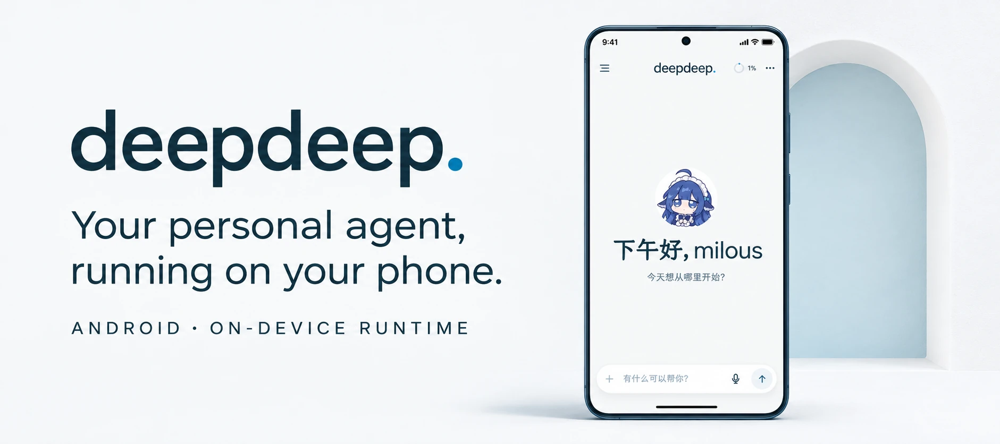
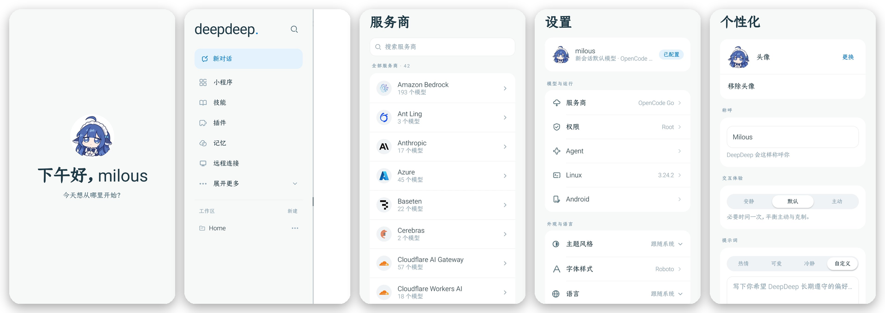

<div align="center">


# DeepDeep

**A personal agent for Android**

<sub>Deep understanding, always with you.</sub>

[简体中文](README.md) · [English](README.en.md)

<a href="https://github.com/Sadami3066/DeepDeep/releases"></a>


<br />
<br />



</div>

[Overview](#overview) · [Feature Preview](#feature-preview) · [UI](#ui) · [Getting Started](#getting-started) · [Installation & Configuration](#installation--configuration) · [Development](#development) · [Docs](#docs--feedback) · [Contributing](#contributing) · [License](#license)

## Overview

DeepDeep is built to match the built-in assistants from phone makers. It supports one-press wake-up from the power button, with voice input and output in a floating layer.

It includes a complete agent harness: tools, skills, long-term memory, MCP extensions, and a plugin system. It runs on the phone without a server or an always-on computer. Press and hold the power button, say what you need, and it starts working.

DeepDeep includes a lightweight Linux environment that covers 99% of desktop office and coding tasks while running on Android. It can also manage phone files: find photos, clean up junk, organize files, write code, optimize the phone, and use screen tools or a virtual display to operate other apps.

A broad plugin ecosystem connects external services through MCP and CLI for remote work: Feishu, WeCom, Amap, McDonald's MCP, Notion, email, and more. It is intended to improve efficiency across work, daily life, and study.

DeepDeep is open source and built for transparency. It does not run its own backend service; apart from the model-provider requests you configure, it does not collect or upload data.

Use of DeepDeep is subject to the user agreement in the app.

Version 1.0.3 is distributed through [GitHub Releases](https://github.com/Sadami3066/DeepDeep/releases). The source code is public.

## Feature Preview

<table>
<tr>
<td width="33%" valign="top" align="center">

https://github.com/user-attachments/assets/a6e1d2c3-3d13-4ce4-afec-aaa0d1b5bf5b

<b>Multi-modal interaction</b><br />
<sub>Wake with the power button; voice and text input.</sub>
</td>
<td width="33%" valign="top" align="center">

https://github.com/user-attachments/assets/bfeaac5e-da31-4790-a9e3-3f7e9a6b2018

<b>Availability monitor</b><br />
<sub>Watches booking systems and reserves a slot when one opens.</sub>
</td>
<td width="33%" valign="top" align="center">

https://github.com/user-attachments/assets/32019883-ca2d-40f6-b18f-6c941131cc64

<b>Virtual-screen app control</b><br />
<sub>Works in the background without interrupting you.</sub>
</td>
</tr>
<tr>
<td width="33%" valign="top" align="center">

https://github.com/user-attachments/assets/9deb4845-514d-4c42-a197-0fa80f2cd9f4

<b>Mini apps</b><br />
<sub>Builds an app and adds it to the home screen.</sub>
</td>
<td width="33%" valign="top" align="center">

https://github.com/user-attachments/assets/d387b523-4283-4269-9302-63f135e3541c

<b>Universal scanner</b><br />
<sub>One entry point for QR codes across ecosystems, with custom routing rules.</sub>
</td>
<td width="33%" valign="top" align="center">

https://github.com/user-attachments/assets/11c0d18c-192d-4e15-98bf-c6fb95498fae

<b>Remote connection</b><br />
<sub>Connects to DSH on your computer.</sub>
</td>
</tr>
</table>

## UI

<p align="center"></p>

<sub>Home, drawer, model providers, settings, and personalization.</sub>

## Getting Started

1. **Download the APK.** Get the latest version from [GitHub Releases](https://github.com/Sadami3066/DeepDeep/releases).
2. **Install and open.** Android 10 or later is required. The first launch opens a setup guide; follow it, or skip it and complete the steps later in Settings.
3. **Connect a model.** Open **Settings → Providers**, choose a provider, and enter an API key or sign in with OAuth. DeepSeek or a GPT subscription is recommended.
4. **Initialize Linux.** Open **Settings → System access** and initialize Alpine in the **Linux environment** section. This step is strongly recommended; complete the basic setup as prompted.
5. **Choose system access.** The default tier is Standard. To operate other apps, follow the guide under **Settings → System access** to enable Wireless debugging or Root. When enabling Wireless debugging, you can enter the pairing code from the system notification. If notifications are unavailable, open DeepDeep in split-screen or a floating window, read the code from the wireless pairing screen, and enter it in DeepDeep.

## Installation & Configuration

### Installation

| Item | Description |
|---|---|
| System | Android 10 or later |
| Package | APK from [GitHub Releases](https://github.com/Sadami3066/DeepDeep/releases) |
| Account | No account system; model keys are stored only on the device |
| Upgrade | Install over the same signing key. Changing keys requires uninstalling, which removes local sessions and credentials |
| Network | Conversations go only to the configured model provider; market and update checks access GitHub, which may require a VPN |

### Configuration

| Item | Location | Description |
|---|---|---|
| Model providers | Settings → Providers | 42 providers; API key or browser OAuth |
| System access | Settings → System access | Standard / Wireless debugging / Root; sets the identity for bash and file operations |
| Agent behavior | Settings → Agent behavior | Screen control is off by default |
| Linux | Settings → System access → Linux environment | Initialize Alpine; install commands, Node, Python, and build toolchains |
| Android integration | Settings → Android settings | Overlay, system assistant, notifications, and share intake |
| Remote connection | Drawer → Remote connection | Pair a computer through [`dsh-mobile`](https://github.com/saya-ch/dsh-mobile) |
| Plugins | Drawer → Plugins | Import signed `.ddp` packages; inspect capabilities and status |
| Memory | Automatic | Consolidated at session end; searchable and injectable into the current conversation |

## Boundaries

| Item | Description |
|---|---|
| **Linux isolation** | Alpine runs in a proot user space, not a security sandbox |
| **Plugin permissions** | Plugins share the app process and UID; there is no sandbox |
| **Approval** | Three permission tiers (Standard, Wireless debugging, Root); commands are not confirmed individually |
| **Execution** | Tasks run on the device; closing the app stops them, and goal continuation is process-local |
| **Protected pages** | Payment and password pages cannot be captured; the agent returns control to the user |
| **Distribution** | 1.0.3 is distributed through GitHub Releases and is not available in an app store; the source code is public |

## Development

<details>
<summary><b>Modules, build, and verification</b></summary>

| Module | Responsibility |
|---|---|
| `app/` | Compose UI, chat, files, settings, plugin pages, mini app container, and screen assembly |
| `runtime/` | Agent runtime: sessions, tools, memory, jobs, timers, and plugin loading |
| `runtime-api/` | Pure JVM contracts between runtime and host |
| `shell/` | proot and ADB/Root privileged channels |
| `design/` | Theme, icons, shared components, and design tokens |
| `plugin-api/` | Plugin contracts and publishable SDK |

Development requirements:

- JDK 17; the build pins Java 17 (`jvmToolchain` 17).
- Android SDK Platform 36 and build-tools 36.0.0 (about 5.6 GB).
- At least 8 GB of RAM and 10 GB of free disk space. A cold first build takes roughly 15–30 minutes, including JitPack building the SDK on demand and downloading dependencies.
- The Android SDK defaults to `~/Library/Android/sdk` on macOS and is commonly at `~/Android/Sdk` on Linux. The setup script checks environment variables, then an existing `local.properties`, then common paths; use `ANDROID_HOME` or `ANDROID_SDK_ROOT` to override.
- Windows is not supported natively: the scripts need bash and flock. Use WSL2, Linux, or macOS.

```bash
./scripts/dev-setup.sh            # First run: check JDK and Android SDK, install Platform 36/build-tools as needed, build debug APK
./scripts/build.sh quick          # Daily compile
./scripts/build.sh test           # Targeted unit tests
./scripts/build.sh check          # Full verification (same as check.sh --full)
./scripts/build.sh release        # Build the release APK after full verification
./scripts/check.sh                # Compile + unit tests + lint + module boundaries + APK
./scripts/check.sh --full         # Before delivery: add the plugin SDK ABI baseline
./scripts/check.sh --device       # Also install over the device and launch
./scripts/plugin-e2e.sh           # Plugin end-to-end on a device
./scripts/plugin-bundles-e2e.sh   # Regression for the four official plugin bundles (build the plugin repository first)
./scripts/plugin-api-abi.sh       # Check the plugin SDK ABI baseline alone (--update refreshes it)
```

The Agent SDK comes from JitPack: `com.github.Sadami3066.DeepDeep-KotlinSDK:pi-coding-agent-android:v0.6.3` (the version is `pi` in `gradle/libs.versions.toml`). On the first build, JitPack may compile the SDK on demand, which can take minutes or time out; once the dependency is cached, later builds can run offline. In an offline environment, run a full build online once first.

Device scripts need `adb`. With more than one device online, set `ANDROID_SERIAL`; without it the script uses the only online device and fails when several are online. The plugin end-to-end scripts look for `plugins` / `DeepDeep-Official-Plugins` next to the repository or one directory above; set `PLUGINS_DIR` when they live elsewhere. Both install the debug build with `adb install` and push fixtures into the app's external private directory, so **no root is needed**; `plugin-e2e.sh` also expects a signed `sample` fixture (DeepDeep-Plugins currently ships only `template`, so point `E2E_DDP` at a signed bundle). `plugin-api-abi.sh` needs `unzip` and `javap` (`jar` is optional and falls back to `unzip`).

An x86_64 AVD can run unit tests, compile, install and launch the app, run the plugin end-to-end scripts, and cover most UI work; the Linux environment, screen control, and Root-tier system access require an arm64 device.

All Gradle calls go through `./scripts/gradlew-locked`; concurrent local builds may run out of memory.

See the [Developer Guide](docs/DEVELOPER_GUIDE.md) and [Plugin Development](docs/PLUGIN_DEV.md) for details.

</details>

## Docs & Feedback

- [User Guide](docs/USER_GUIDE.md): installation, system access, Linux, plugins, mini apps, remote connection, and FAQ.
- [Developer Guide](docs/DEVELOPER_GUIDE.md): environment, modules, build, tests, and conventions.
- [Plugin Development](docs/PLUGIN_DEV.md): plugin contracts, manifest, signing, lifecycle, and UI extensions.
- [Release Notes](docs/RELEASE.md): signing, packaging, and distribution.
- [Changelog](CHANGELOG.md): features and fixes by version.

## Contributing

Issues and pull requests are welcome. Read [CONTRIBUTING.md](CONTRIBUTING.md) before opening a PR. Plugin authors can start with [Plugin Development](docs/PLUGIN_DEV.md) and [DeepDeep-Official-Plugins](https://github.com/Sadami3066/DeepDeep-Official-Plugins). Please report security issues privately instead of opening a public issue.

## License

Original code is licensed under [Apache-2.0](LICENSE). Third-party components, fonts, and icons are listed in [THIRD_PARTY_NOTICES.md](THIRD_PARTY_NOTICES.md).

---

<sub>Built on [pi](https://pi.dev) · [DeepDeep-KotlinSDK](https://github.com/Sadami3066/DeepDeep-KotlinSDK) · Alpine Linux · Jetpack Compose</sub>
