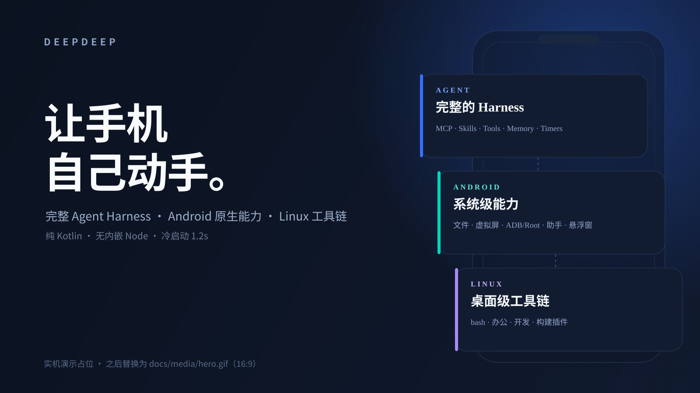
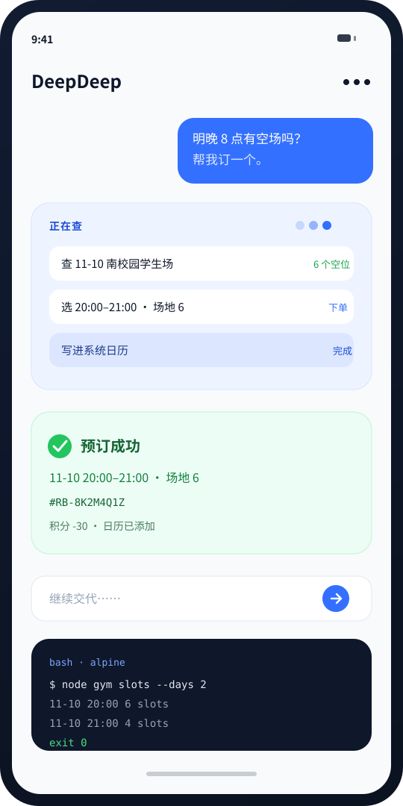
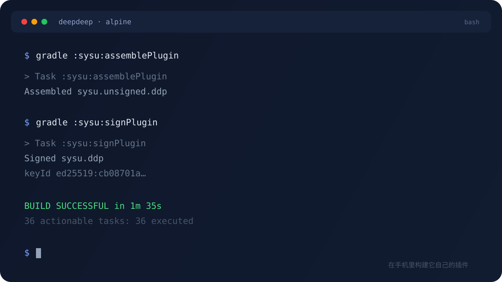

<div align="center">


# DeepDeep

**让手机自己动手。**

<sub>A phone that works for you.</sub>

完整 Agent Harness、Android 原生能力和一台 Linux，装在同一个 App 里。

<a href="https://github.com/Sadami3066"></a>


<br/>
<br/>



<sub>实机演示位 · 之后替换为 16:9 的 <code>hero.gif</code></sub>

</div>

DeepDeep 不是一个更大的聊天框。

它把三样东西放进同一部手机：一个完整的 Agent Harness、Android 的系统能力、一台随身的 Linux。于是它接得住任务，也够得到系统——**不需要 root**。

## 三件事，同时成立

| 完整的 Agent | 一部真正的 Android | 一台随身的 Linux |
|---|---|---|
| 工具、MCP、技能、插件、记忆、定时任务，都在同一个循环里 | 文件、虚拟屏、ADB/Root、系统助手、悬浮窗 | `bash`、办公、开发、构建插件 |
| 它知道下一步该调用什么，也知道做完了没有 | 它能在后台操作 App，不抢你正在用的主屏 | 它能在手机里编译代码，甚至重新构建自己 |

## 一个完整的 Agent

从「想」到「做」，中间不缺零件。

| | |
|---|---|
| **工具** | 读写文件、执行命令、操作屏幕、读写日历、搜索网页；失败会重试，长任务转后台 |
| **MCP** | Streamable HTTP + OAuth，工具按需加载，不把几百个 schema 塞进上下文 |
| **技能** | 把你的流程写成 `SKILL.md`，需要时加载；也可以让 Agent 自己写 |
| **插件** | 工具、技能、提示词段和自绘页面，一个 `.ddp` 全部带走 |
| **记忆** | 分层长期记忆，自动沉淀，可搜索，可注入当前会话 |
| **定时任务** | 五段 cron，绑定会话；到点把结果投递回原对话 |

模型有 42 家 Provider，API Key 或 OAuth 都行；模型与思考档按会话独立，不绑定全局。

## 它住得够深

很多手机 Agent 只能「看屏幕、点按钮」。DeepDeep 还能碰文件、碰系统、碰权限。

<table>
<tr>
<td width="330" valign="top"></td>
<td valign="top">

- **本地文件**：真实绝对路径，读写、预览、分享、交付；不经过中转服务器。
- **虚拟屏幕**：在后台虚拟屏里启动 App、点击、滑动、输入，主屏继续用。
- **Shell**：普通档 `bash`；需要系统能力时，无线调试 `adb_shell` 或 Root `root_shell`。
- **系统助手**：设为默认助手后，长按电源键或助手手势唤起，直接在任意 App 上交代任务。
- **悬浮窗**：小鲸鱼显示进度、提问和交付；点开是实时运行面板，长按看虚拟屏。

</td>
</tr>
</table>

还有三个小东西，平时最常用：

- **小程序**：Agent 现场写的 HTML 轻应用，能读自己的数据、调用一次性 Agent，还能添加到桌面。
- **万能扫一扫**：相机里同时识别多个二维码，按内容路由到对应 App 的扫一扫、浏览器或剪贴板。
- **帮我盯**：一句话挂一个后台任务，轮询网页或接口；条件满足就自动执行，结果回到对话。

## 它也是一台 Linux



Alpine 跑在 proot 里，不需要 root。常用命令、Node、Python、数据库客户端都能装；办公套件和编译工具链也能装。

更有意思的是：给它源码和 Android SDK，它能在手机里编译插件，甚至重新构建自己。喜欢什么功能，改就是了。

## 它连得上你的电脑

抽屉里的「远程连接」通过 `dsh-mobile` 接上电脑上的 DSH：

- 扫码或粘贴配对链接，首次连接固定证书，之后只信任同一台电脑。
- 局域网优先，不通时自动走远程入口；多台电脑按 installationId 合并成一行。
- 连接页就是电脑上的 DSH 手机版，会话、消息、工作区与电脑一致。

手机负责随手交代，电脑负责重活。

## 纯 Kotlin，快得不像 Agent

| | |
|---|---|
| **冷启动** | 1.2 秒 |
| **运行时** | pi2kotlin：Agent 循环、工具调度、会话存储都是 Kotlin |
| **不背运行时** | App 本身不内嵌 Node；需要 Node 的插件在自己的 Linux 里装 |
| **插件** | 纯 Kotlin `plugin-api`，18 项能力声明，热升级不重启 |

DeepDeep 把 Agent 内核直接编译进 App，Linux 只在需要时启动；不需要为了跑 Agent 常驻一个 Node 运行时。

## 插件是 Kotlin

插件不是脚本，是能声明能力、提供页面、参与生命周期的 Kotlin 模块：

```json
{
  "id": "com.example.myplugin",
  "version": "1.0.0",
  "entryClass": "com.example.MyPlugin",
  "capabilities": ["linux", "files", "network", "ui"]
}
```

- 能力清单在安装前展示，宿主只注入声明过的服务。
- 插件可以带自己的设置页、登录页和状态页，不用回到主界面。
- 更新必须同钥；发布者、sha256、能力清单都在确认页里。

> 插件与 App 同进程、同权限，没有沙箱。只安装可信来源的 `.ddp`。

## 它记得住

记忆不是一段越来越长的聊天记录，而是分层的：

| 区域 | 放什么 |
|---|---|
| **用户与我** | 你是谁、偏好、习惯、长期约定 |
| **当下与将来** | 正在做的事、接下来的安排 |
| **经验与教训** | 踩过的坑、可复用的方法 |
| **日记 / 月 / 年** | 原始记录、按月汇总、按年回看 |

会话结束时自动沉淀，按天和按月汇总；需要时搜索，或把摘要注入当前会话。它不会把所有历史都塞进上下文，但该记得的不会丢。

## 市场

插件、技能、MCP 统一放在 [DeepDeep 市场](https://github.com/Sadami3066/deepdeep-market)：

- 索引经过 ECDSA 签名，制品核对 sha256。
- 插件、技能、MCP 三类条目，装完即用，不用自己找服务器、配 JSON。
- 官方插件：飞书、企业微信、中山大学 CLI、小米云服务。

App 出厂不带插件；能力按需装，卸载会带走插件文件、登录信息与技能。

## 装上

1. **申请内测**：[联系作者](https://github.com/Sadami3066) 获取安装包。
2. **连一个模型**：推荐 DeepSeek，也可以选 Anthropic、OpenAI、Gemini、OpenRouter、Kimi 等。
3. **初始化 Linux**：首次进入「Linux 设置」按提示装好 Alpine。
4. **选权限档**：先用普通档；要操作 App 时再开无线调试或 Root。
5. **说一句话**：比如「看看我明天几点上课」「把这份课件整理成复习提纲」。

首次安装会走 6 屏引导，可以跳过。

## 边界

| | |
|---|---|
| **不是安全沙箱** | Linux 是 proot 用户空间；插件与 App 同权限 |
| **不做二次审批** | 只有普通 / ADB / Root 三档；命令执行前不会再逐条问你 |
| **不是云手机** | 任务都在你手机上跑，关掉 App 就停；目标续跑只在进程内有效 |
| **不保证受保护页面** | 支付、密码页禁止截图，Agent 会把控制权交还给你 |
| **暂时不上架** | 1.0.0 本地分发，源码未公开；接口与插件 API 仍可能变化 |

<details>
<summary><b>架构与从源码构建</b></summary>

```text
app/          Compose UI · 聊天 · 文件 · 设置 · 插件页 · 小程序
runtime/      pi2kotlin · memory · tools · session
plugin-api/   插件契约与能力服务
design/       设计系统与图标
shell/        ADB / Root 特权通道
```

需要 JDK 17+、Android SDK Platform 36 + build-tools 36.0.0。

```bash
./scripts/dev-setup.sh        # 首次：检查环境、写 local.properties、拉 SDK、出 APK
./scripts/check.sh            # 日常：编译 + 单测 + lint + 模块边界 + APK
./scripts/check.sh --full     # 交付前：再加插件 SDK ABI 基线
./scripts/check.sh --device   # 再加覆盖安装到手机并启动
```

`dev.pi` SDK 由 Gradle 任务从 pi2kotlin `v0.4.0` Release 下载并校验 sha256，不依赖本机 `~/.m2`。所有 Gradle 调用走 `./scripts/gradlew-locked`（全局串行锁；本机并发构建会 OOM）。

</details>

## 状态

**1.0.0 · Private Beta。** 目前由作者本地构建与分发，没有上架应用商店；源码暂未公开。

使用说明见 [docs/USER_GUIDE.md](docs/USER_GUIDE.md)，构建与模块见 [docs/DEVELOPER_GUIDE.md](docs/DEVELOPER_GUIDE.md)，插件开发在 [docs/PLUGIN_DEV.md](docs/PLUGIN_DEV.md)。

## License

自有代码 [Apache-2.0](LICENSE)。第三方组件与字体、图标许可见 [THIRD_PARTY_NOTICES.md](THIRD_PARTY_NOTICES.md)。

---

<sub>Built on [pi](https://pi.dev) · [pi2kotlin](https://github.com/Sadami3066/DeepDeep-KotlinSDK) · Alpine Linux · Jetpack Compose</sub>
