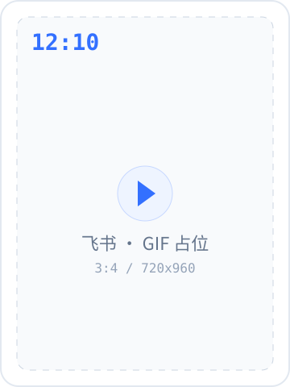

<table>
<tr>
<td> &nbsp;<b>DEEPDEEP</b></td>
<td align="right"><sub>Android 10+ · 1.0.0 · Private beta</sub></td>
</tr>
</table>

<h1>你的手机里，<br/>住着一台小电脑。</h1>

<sub>A personal agent that lives on your Android phone.</sub>

DeepDeep 把 Agent、Alpine Linux 和一层可编程界面装进 Android。

它不只是聊天，它替你把事做完。

<table>
<tr>
<td width="380" valign="top"></td>
<td valign="top">

<p><code>01 对话</code> 42 家 Provider，按会话独立</p>
<p><code>02 终端</code> Alpine、bash，Node / Python 按需安装</p>
<p><code>03 屏幕</code> 后台虚拟屏，点按滑动输入</p>

<p><a href="https://github.com/Sadami3066"><b>内测申请 →</b></a><br/>
<sub>实机演示录制中 · 规格见 <a href="docs/media/SHOTS.md">docs/media/SHOTS.md</a></sub></p>

</td>
</tr>
</table>

---

## 不是聊天框，是运行环境

大多数手机 Agent 停在「看屏幕、点按钮」。

DeepDeep 多给了两层：一个真正的 Linux，和一套能装东西的插件与小程序。于是同一台手机既能查教务、跑脚本，也能订场地、写页面——**不需要 root**。

> 它更像一台能揣进口袋的 Linux 机器，只是恰好会聊天。

## 一天

| 时间 | 你说 | 它做 | 画面 |
|---|---|---|---|
| **07:50** | 今天几节课？ | `sysu jwxt schedule --today`，8:00 第一门 |  |
| **12:10** | 群里这周定了什么？ | 飞书插件翻消息和文档，整理出 4 条决定 |  |
| **21:00** | 盯南校园羽毛球，有空位就订 | 60 秒轮询，抢到 20:00 场，扣 30 积分 |  |

<sub>画面为 GIF 占位，实机录制中。</sub>

<details>
<summary><b>一次调用大概长这样</b></summary>

<sub>示意；具体输出取决于插件、模型和权限档。</sub>

```text
你  今天几节课？
它  sysu jwxt schedule --today
    → 3 门课：08:00 高等数学，10:00 大学物理，14:00 英语

你  把这周的课件整理成提纲
它  bash: find ~/Downloads -name '*.pdf'
    read → 12 份 PDF → 输出 markdown

你  给我做个课程表
它  miniapp_create → app/index.html
    present → 已添加到桌面
```

</details>

## 剖面

```text
Android
├─ Compose UI          聊天 · 文件 · 设置 · 插件页 · 小程序
├─ Agent runtime       pi2kotlin · pi-ai · pi-agent
├─ Tools               bash · screen_* · job/timer · miniapp · MCP
├─ Alpine (proot)      Node · Python · shell
└─ Privileged bridge   ADB（无线调试）/ Root（可选）
```

模型用你自己的 Key，会话与文件留在设备上。没有 DeepDeep 账号，也没有中转服务器。

## 权限阶梯

| 档位 | 工具 | 说明 |
|---|---|---|
| **普通** | `bash` | proot 用户空间，能跑命令和脚本；**不是安全沙箱** |
| **无线调试** | `adb_shell` | 用系统配对码连接，App 内嵌 ADB 守护进程；重启后需重新打开无线调试 |
| **Root** | `root_shell` | 交给系统 root 管理器授权，只在后端可用时注册工具 |

屏幕操作开关默认关闭；打开后还需要 ADB 或 Root 后端实际可用。Agent 默认在**后台虚拟屏**里操作，不抢占你正在用的主屏；主屏必须显式 `target=main`。

## 插件是器官

App 出厂不带插件。能力靠装：

| 插件 | 能做什么 |
|---|---|
| **飞书** | 通过官方 `lark-cli` 读写消息、日历、云文档、云空间、邮箱与任务 |
| **企业微信** | 扫码授权后操作消息、邮件、文档、日程与待办 |
| **中山大学 CLI** | 课表、成绩、作业、课件下载、体育场馆预约、网费查询与续费 |
| **小米云服务** | 读取笔记、待办、短信、联系人、相册与录音 |

插件、技能与远程 MCP 都可以从 [DeepDeep 市场](https://github.com/Sadami3066/deepdeep-market) 获取；索引经过 ECDSA 签名，制品核对 sha256。

> 插件与 App 同进程、同权限，没有沙箱。只安装可信来源的 `.ddp`；首次安装会展示发布者、sha256 与能力清单，更新必须同钥。

## 界面是长出来的

小程序不是固定模板，而是 Agent 按你的需求现场写的 HTML/CSS/JS：

- 页面通过 bridge 读写自己的 SQLite 数据，按小程序隔离。
- 页面里的 `app.agent.*` 可以编排一次性 Agent，用完即走。
- 做好后「添加到桌面」，点图标直接打开。

课程表、记账、纪念日、抽签、小工具都可以是它。也可以把一次性的任务固化成每天都能点的按钮。

## 它做不到什么

| 边界 | 说明 |
|---|---|
| **不是安全沙箱** | Linux 是 proot 用户空间；插件与 App 同权限。能力给你，边界也给你 |
| **不做二次审批** | 只有普通 / ADB / Root 三档；命令执行前不会再逐条问你 |
| **不是云手机** | 所有任务都在你手机上跑，关掉 App 就停；目标续跑只在进程内有效 |
| **不保证受保护页面** | 支付、密码页禁止截图，Agent 会把控制权交还给你 |
| **暂时不上架** | 1.0.0 本地分发，源码未公开；接口与插件 API 仍可能变化 |

## 装上

1. **申请内测**：[联系作者](https://github.com/Sadami3066) 获取安装包。
2. **连一个模型**：推荐 DeepSeek，也可以选 Anthropic、OpenAI、Gemini、OpenRouter、Kimi 等，支持 OAuth 或 API Key。
3. **初始化 Linux**：首次进入「Linux 设置」按提示装好 Alpine。
4. **选权限档**：先用普通档；要操作 App 时再开无线调试或 Root。
5. **说一句话**：比如「看看我明天几点上课」「把这份课件整理成复习提纲」。

首次安装会走 6 屏引导，可以跳过。

<details>
<summary><b>从源码构建</b></summary>

需要 JDK 17+、Android SDK Platform 36 + build-tools 36.0.0。

```bash
./scripts/dev-setup.sh        # 首次：检查环境、写 local.properties、拉 SDK、出 APK
./scripts/check.sh            # 日常：编译 + 单测 + lint + 模块边界 + APK
./scripts/check.sh --full     # 交付前：再加插件 SDK ABI 基线
./scripts/check.sh --device   # 再加覆盖安装到手机并启动
```

`dev.pi` SDK 由 Gradle 任务从 pi2kotlin `v0.4.0` Release 下载并校验 sha256，不依赖本机 `~/.m2`。所有 Gradle 调用走 `./scripts/gradlew-locked`（全局串行锁；本机并发构建会 OOM）。

</details>

## 状态

**1.0.0 · Private Beta。** 目前由作者本地构建与分发，没有上架应用商店；源码暂未公开。

已知边界都写在 [docs/GUIDE.md](docs/GUIDE.md)，设计取舍在 [docs/DECISIONS.md](docs/DECISIONS.md)，插件开发在 [docs/PLUGIN_DEV.md](docs/PLUGIN_DEV.md)。

## License

自有代码 [Apache-2.0](LICENSE)。第三方组件与字体、图标许可见 [THIRD_PARTY_NOTICES.md](THIRD_PARTY_NOTICES.md)。

---

<sub>Built on [pi](https://pi.dev) · [pi2kotlin](https://github.com/Sadami3066/DeepDeep-KotlinSDK) · Alpine Linux · Jetpack Compose</sub>
