<div align="center">


# DeepDeep

**Android 上的个人 Agent**

<sub>对话、系统操作与 Linux 环境，运行在同一个应用内。</sub>

<a href="https://github.com/Sadami3066"></a>


<br />
<br />


</div>

[概览](#概览) · [快速开始](#快速开始) · [安装与配置](#安装与配置) · [功能](#功能) · [开发](#开发与构建) · [文档](#文档与反馈) · [License](#license)

## 预览

<table>
<tr>
<td width="33%" align="center">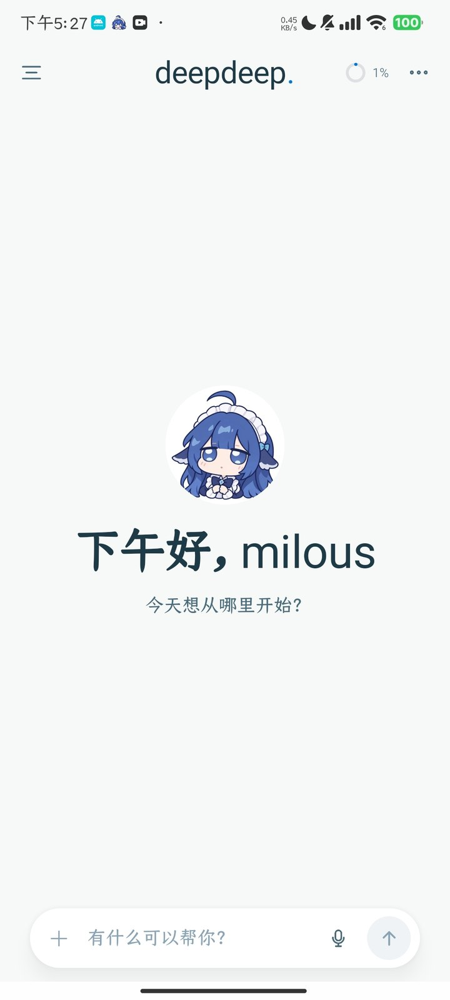<br /><sub>主界面</sub></td>
<td width="33%" align="center">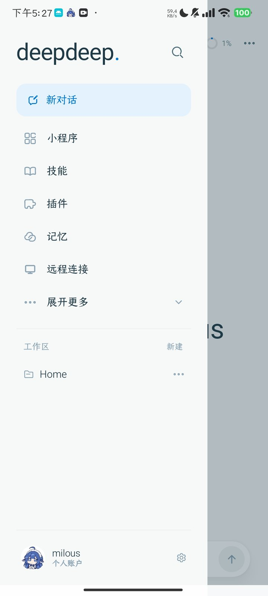<br /><sub>抽屉</sub></td>
<td width="33%" align="center">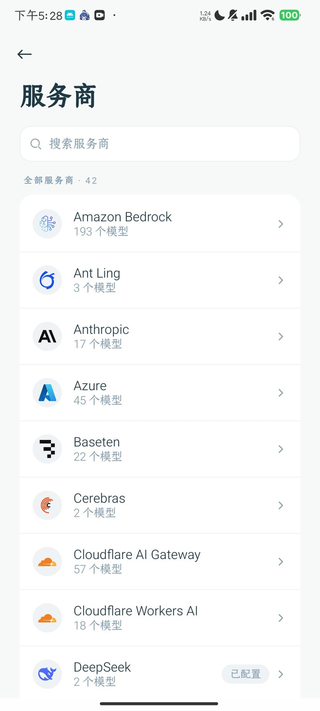<br /><sub>模型服务商</sub></td>
</tr>
</table>

<sub>截图来自 1.0.0 内测版。各功能的演示视频见下文。</sub>

## 概览

DeepDeep 面向需要在手机上完成实际任务的用户。它将 Agent 运行时、Android 系统接口和 Alpine Linux 环境集成在同一个应用中，可以处理本地文件、检索网页、操作应用、执行 shell 命令，也可以按计划在后台运行任务。应用使用 Kotlin 与 Jetpack Compose 编写，大部分功能不需要 root。

适合需要在手机上处理文件、检索资料、操作应用、运行脚本，或把手机作为随身 Linux 环境的用户。

当前版本为 1.0.0，处于小范围内测，安装包由作者分发，源码暂未公开。

## 快速开始

1. **获取安装包。** 当前版本通过内测分发，请联系 [@Sadami3066](https://github.com/Sadami3066) 获取 `DeepDeep-1.0.0.apk`。
2. **安装并打开。** 系统要求 Android 10 及以上。首次启动会进入 6 屏引导；可以跳过，之后在设置中逐项完成。
3. **连接模型。** 进入「设置 → 服务商」，选择服务商并填写 API Key，或使用 OAuth 登录。模型与思考档按会话独立选择。
4. **初始化 Linux。** 进入「设置 → Linux 设置」完成 Alpine 初始化；之后可以在对话中直接使用 `bash`。
5. **选择权限。** 默认使用普通档。需要操作其他应用时，在「设置 → 权限」中开启无线调试或 Root。

如果使用 adb 安装：

```bash
adb install -r DeepDeep-1.0.0.apk
```

## 安装与配置

### 安装

| 项目 | 说明 |
|---|---|
| 系统 | Android 10 及以上 |
| 安装包 | APK，当前由作者本地签名并分发 |
| 账号 | 没有账号系统；模型 Key 仅保存在本机 |
| 升级 | 使用同一签名覆盖安装；更换签名需要先卸载，卸载会删除本机会话与凭据 |
| 网络 | 对话内容只发送给已配置的模型厂商；市场与更新检查访问 GitHub |

首次启动的 6 屏引导依次覆盖欢迎、账号、模型、通知与悬浮窗、Linux 环境和权限。所有步骤都可以跳过，之后在设置中补齐。

### 配置

| 配置项 | 位置 | 说明 |
|---|---|---|
| 模型服务商 | 设置 → 服务商 | 支持 42 家 Provider；API Key 或浏览器 OAuth |
| 权限 | 设置 → 权限 | 普通 / 无线调试 / Root 三档；屏幕操作默认关闭 |
| Linux | 设置 → Linux 设置 | 初始化 Alpine；安装命令、Node、Python 与编译工具链 |
| Android 集成 | 设置 → Android 设置 | 悬浮窗、系统助手、通知与分享接收 |
| 远程连接 | 抽屉 → 远程连接 | 通过 `dsh-mobile` 配对电脑 |
| 插件 | 抽屉 → 插件 | 导入签名 `.ddp`；查看能力清单与运行状态 |
| 记忆 | 自动 | 会话结束时沉淀；可搜索，也可注入当前会话 |

## 功能

### Agent 运行时

Agent 循环、工具调度、会话存储与插件宿主均在 App 进程内运行。模型可以调用文件、命令、屏幕、日历、网页等工具；长任务通过 `job_start` 转为后台任务，定时任务使用五段 cron 并绑定当前会话。MCP 工具通过 `tool_search` 按需加载，避免将全部 schema 注入上下文。

- **工具**：读写文件、执行命令、操作屏幕、读写日历、搜索网页。失败会重试，长任务可以转到后台。
- **技能**：以 `SKILL.md` 描述流程，按需加载；也可以让 Agent 根据任务编写新技能。
- **自动化**：后台任务、五段 cron 定时任务、会话级目标，以及「帮我盯」这类轮询任务。
- **MCP**：支持 Streamable HTTP 与 OAuth；工具按需加载。
- **会话**：会话以 JSONL 保存；支持置顶、归档、重命名与单会话导出。

<p align="center">
  <a href="https://github.com/Sadami3066/DeepDeep/releases/download/demo-20261109/deepdeep-monitor.mp4">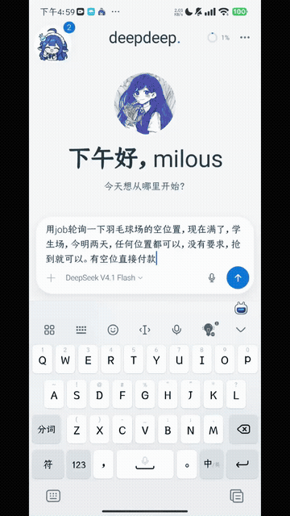</a><br />
  <sub>在对话中查询场馆空位并创建轮询任务；工具调用、运行状态与结果都保留在会话中。点击图片查看完整视频。</sub>
</p>

### Android 系统集成

权限分为普通、无线调试与 Root 三档。普通档提供 `bash`、文件与网络；无线调试增加 `adb_shell`，可以操作屏幕和系统设置；Root 档增加 `root_shell`。屏幕操作默认关闭，开启后还需要对应的后端实际可用，`screen_*` 工具才会出现。

Agent 默认在后台虚拟屏中运行应用，不抢占当前主屏；需要操作主屏时，必须显式指定 `target=main`。虚拟屏连续 15 分钟没有 Agent 操作会自动关闭。支付、密码等受保护页面禁止截图，Agent 会把控制权交还给你。

<table>
<tr>
<td width="55%" align="center"><a href="https://github.com/Sadami3066/DeepDeep/releases/download/demo-20261109/deepdeep-phone-control.mp4">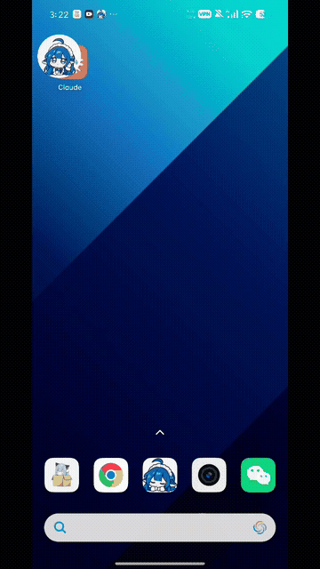</a><br /><sub>在悬浮窗中启动虚拟屏、输入文字，并切换到其他应用完成操作。点击查看完整视频。</sub></td>
<td width="45%" align="center">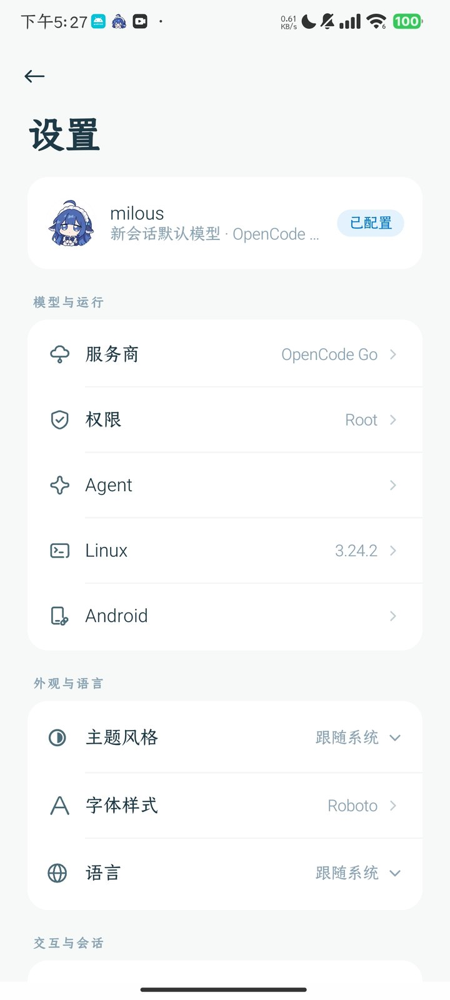<br /><sub>权限与运行环境</sub></td>
</tr>
</table>

其他系统集成：

- **本地文件**：使用真实绝对路径读写、预览、分享与交付，不经过中转服务器。
- **系统助手**：设为默认助手后，长按电源键或使用助手手势唤起，在任意应用上直接交代任务。
- **悬浮窗**：显示运行进度、待处理提问和交付结果；点开是运行面板，长按可以查看虚拟屏预览。
- **分享接收**：从其他应用分享图片、文件或文本，会插入当前会话或预填输入框。
- **通知**：后台任务、定时任务和插件消息通过通知投递，点击回到对应会话。

### Linux 环境

Alpine 通过 proot 运行，不依赖 root。首次在「设置 → Linux 设置」初始化后，可以直接使用 `bash`。常用命令、Node、Python、数据库客户端、办公套件和 Android 编译工具链可以按需安装。

<p align="center">
  
  <br />
  <sub>在手机内执行 shell 命令与构建任务。</sub>
</p>

工作文件默认位于 App 的工作区。文件工具使用绝对路径，工作区只是默认位置，不是访问边界；这样 Linux、插件与 Agent 可以复用同一套路径。

### 模型与对话

支持 42 家 Provider，API Key 与浏览器 OAuth 均可使用。模型和思考档按会话独立，切换会话不会影响其他对话。

对话支持 Markdown、代码块、表格、图片、文件、语音输入与朗读。附件最多 20 个，单文件上限 1 GB；拍照界面可以同时识别多个二维码。输入区右上角的圆环显示上下文占用，点开可以查看输入、输出、缓存与费用；长会话可以用 `/compact` 压缩。

### 插件

插件是 Kotlin 代码模块，实现 `plugin-api` 契约，打包为签名 `.ddp`，由宿主在 App 进程内加载。插件可以提供工具、技能、提示词段、会话 hooks、Compose 页面和消息卡。

```json
{
  "id": "com.example.myplugin",
  "version": "1.0.0",
  "entryClass": "com.example.MyPlugin",
  "capabilities": ["linux", "files", "network", "ui"]
}
```

清单中的 `capabilities` 声明插件实际使用的宿主服务，当前共 18 项。安装确认页会展示名称、版本、体积、sha256、发布者、能力清单和将提供的工具/技能/页面；宿主只注入声明过的服务。更新必须使用同一发布者密钥。新版本在无忙碌会话时立即激活，忙碌会话结束后自动生效，不需要重启 App。

插件与 App 同进程、同权限，没有沙箱。只安装可信来源的 `.ddp`。

### 记忆

记忆按用途分层，不把所有历史都放进上下文：

| 区域 | 内容 |
|---|---|
| **用户与我** | 身份、偏好、习惯、长期约定 |
| **当下与将来** | 正在处理的任务、计划与承诺 |
| **经验与教训** | 已解决的问题、可复用的方法 |
| **日记 / 月 / 年** | 原始记录、月度汇总、年度回看 |

会话结束时自动沉淀，按天和按月汇总；需要时可以搜索，或将摘要注入当前会话。

<p align="center">
  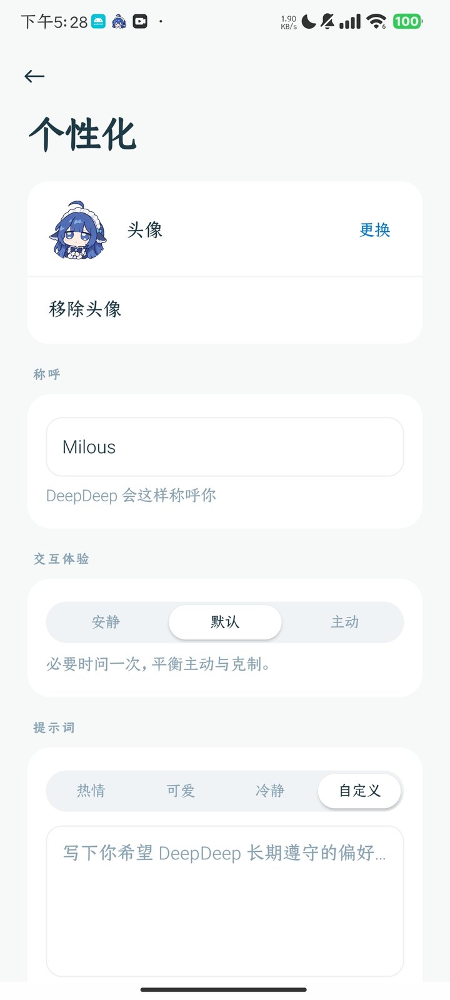
  <br />
  <sub>称呼、交互风格与头像保存在本机。</sub>
</p>

### 小程序与常用工具

**小程序**是 Agent 根据需求生成的 HTML/CSS/JS 页面。页面通过 bridge 读写自己的 SQLite 数据，也可以调用 `app.agent.*` 编排一次性 Agent；完成后可以添加到桌面，点击图标直接打开。

**万能扫一扫**在相机中同时识别多个二维码，按内容路由到对应应用的扫一扫、浏览器或剪贴板。

**帮我盯**让 Agent 启动后台任务，轮询网页或接口；条件满足后自动执行下一步，例如查询场馆空位并在出现空位时下单。

<table>
<tr>
<td width="33%" valign="top" align="center"><a href="https://github.com/Sadami3066/DeepDeep/releases/download/demo-20261109/deepdeep-miniapp.mp4">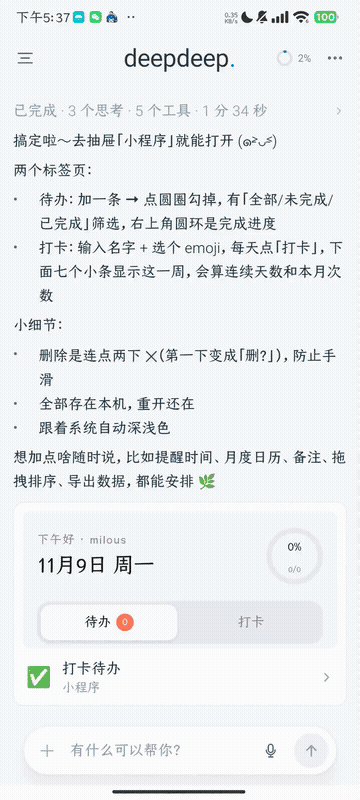</a><br /><b>小程序</b><br /><sub>对话生成「打卡待办」，添加到桌面后直接使用。点击查看完整视频。</sub></td>
<td width="33%" valign="top" align="center"><a href="https://github.com/Sadami3066/DeepDeep/releases/download/demo-20261109/deepdeep-scan.mp4">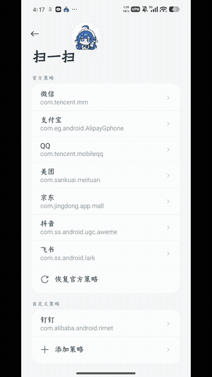</a><br /><b>万能扫一扫</b><br /><sub>相机识别二维码，按内容进入对应应用的扫一扫。点击查看完整视频。</sub></td>
<td width="33%" valign="top" align="center"><a href="https://github.com/Sadami3066/DeepDeep/releases/download/demo-20261109/deepdeep-monitor.mp4">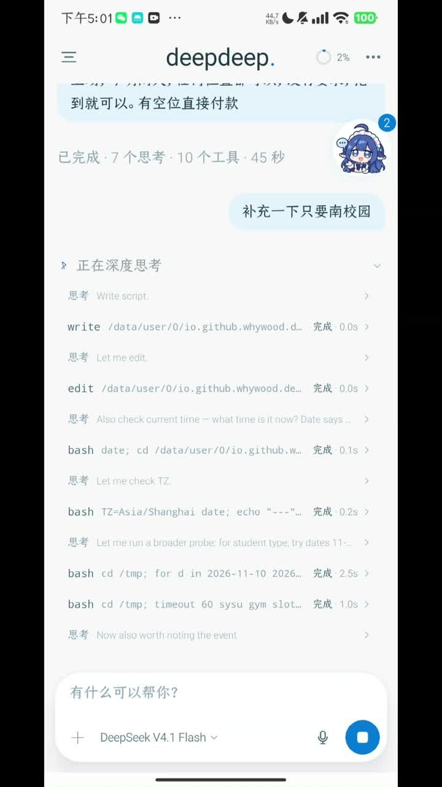</a><br /><b>帮我盯</b><br /><sub>轮询网页或接口，条件满足后执行下一步。点击查看完整视频。</sub></td>
</tr>
</table>

### 远程连接

抽屉中的「远程连接」通过 `dsh-mobile` 连接电脑上的 DSH。扫码或粘贴配对链接后，首次连接会固定电脑证书，之后只信任同一台电脑。局域网优先，不通时自动尝试远程入口；多台电脑按 `installationId` 合并成一行，一次连接一台。连接页就是电脑上的 DSH 手机版，会话、消息和工作区与电脑一致。

<p align="center">
  <a href="https://github.com/Sadami3066/DeepDeep/releases/download/demo-20261109/deepdeep-remote.mp4">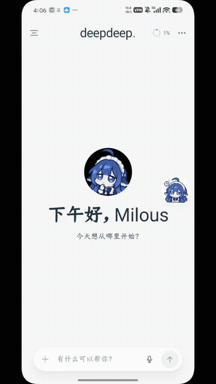</a><br />
  <sub>从手机连接电脑上的 DSH；首次配对固定证书。点击图片查看完整视频。</sub>
</p>

### 市场

插件、技能与远程 MCP 可以从 [DeepDeep 市场](https://github.com/Sadami3066/deepdeep-market) 获取。索引使用 ECDSA 签名，制品会核对 sha256；条目分为插件、技能、MCP 三类。

App 不预装插件。安装后的插件与技能会出现在抽屉和插件页；卸载会移除插件文件、登录信息与技能。

<p align="center">
  
  <br />
  <sub>插件、技能、记忆与远程连接等入口集中在抽屉中。</sub>
</p>

## 设计

DeepDeep 将三类能力放在同一个应用中：Agent 运行时、Android 系统接口和 Linux 环境。Agent 循环、工具调度、会话存储与插件宿主使用 Kotlin 实现，App 本身不内嵌 Node 运行时；需要 Node 的插件在自己的 Linux 环境中安装。Linux 通过 proot 按需启动，不需要 root。

插件与 App 同进程、同权限，安装插件等同于信任其代码。应用不为插件提供独立沙箱；第三方工具源应优先使用 MCP。

## 边界

| 项目 | 说明 |
|---|---|
| **Linux 隔离** | Alpine 运行在 proot 用户空间，不是安全沙箱 |
| **插件权限** | 插件与 App 同进程、同 UID，没有沙箱 |
| **审批** | 只分普通、无线调试、Root 三档，不逐条确认命令 |
| **运行位置** | 任务在本机执行；关闭 App 后停止，目标续跑只在进程内有效 |
| **受保护页面** | 支付、密码等页面禁止截图，Agent 会把控制权交还给你 |
| **分发** | 1.0.0 为本地分发的内测版，未上架应用商店，源码暂未公开 |

## 开发与构建

<details>
<summary><b>模块、构建与验证</b></summary>

| 模块 | 职责 |
|---|---|
| `app/` | Compose UI、聊天、文件、设置、插件页、小程序容器与页面装配 |
| `runtime/` | Agent 运行时：会话、工具、记忆、任务、定时器、插件加载 |
| `runtime-api/` | 纯 JVM 契约，供 runtime 与宿主解耦 |
| `shell/` | proot 与 ADB/Root 特权通道 |
| `design/` | 主题、图标、通用组件与设计 token |
| `plugin-api/` | 插件契约与可发布 SDK |

需要 JDK 17 或更新版本、Android SDK Platform 36、build-tools 36.0.0。

```bash
./scripts/dev-setup.sh        # 首次：检查环境、写 local.properties、拉 SDK、出 APK
./scripts/check.sh            # 日常：编译 + 单测 + lint + 模块边界 + APK
./scripts/check.sh --full     # 交付前：再加插件 SDK ABI 基线
./scripts/check.sh --device   # 再加覆盖安装到手机并启动
```

`dev.pi` SDK 由 Gradle 任务从 pi2kotlin `v0.4.0` Release 下载并校验 sha256，不依赖本机 `~/.m2`。所有 Gradle 调用走 `./scripts/gradlew-locked`；本机并发构建可能 OOM。

更多内容见 [开发指南](docs/DEVELOPER_GUIDE.md) 与 [插件开发](docs/PLUGIN_DEV.md)。

</details>

## 文档与反馈

- [用户指南](docs/USER_GUIDE.md)：安装、权限、Linux、插件、小程序、远程连接与常见问题。
- [开发指南](docs/DEVELOPER_GUIDE.md)：环境、模块、构建、测试与代码约定。
- [插件开发](docs/PLUGIN_DEV.md)：插件契约、清单、签名、生命周期与 UI 扩展。
- [发布说明](docs/RELEASE.md)：签名、打包与分发流程。
- [变更记录](CHANGELOG.md)：按版本记录功能与修复。

## 贡献

当前为私有内测，暂不接受外部 PR。问题与建议可以通过 [@Sadami3066](https://github.com/Sadami3066) 联系作者。插件作者可以从 [插件开发](docs/PLUGIN_DEV.md) 与 [DeepDeep-Official-Plugins](https://github.com/Sadami3066/DeepDeep-Official-Plugins) 开始。

## License

自有代码使用 [Apache-2.0](LICENSE)。第三方组件、字体与图标的许可信息见 [THIRD_PARTY_NOTICES.md](THIRD_PARTY_NOTICES.md)。

---

<sub>Built on [pi](https://pi.dev) · [pi2kotlin](https://github.com/Sadami3066/DeepDeep-KotlinSDK) · Alpine Linux · Jetpack Compose</sub>
