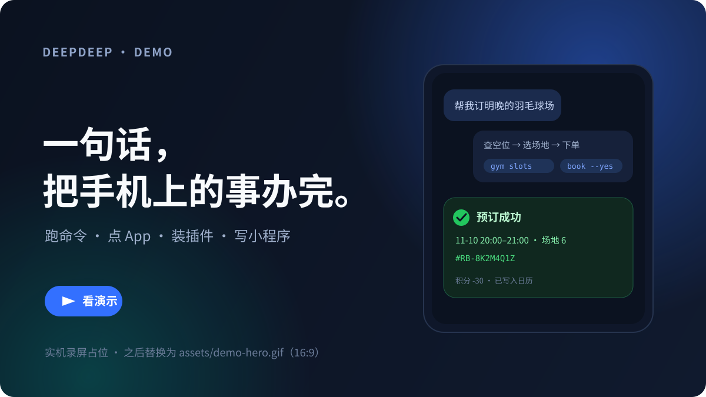
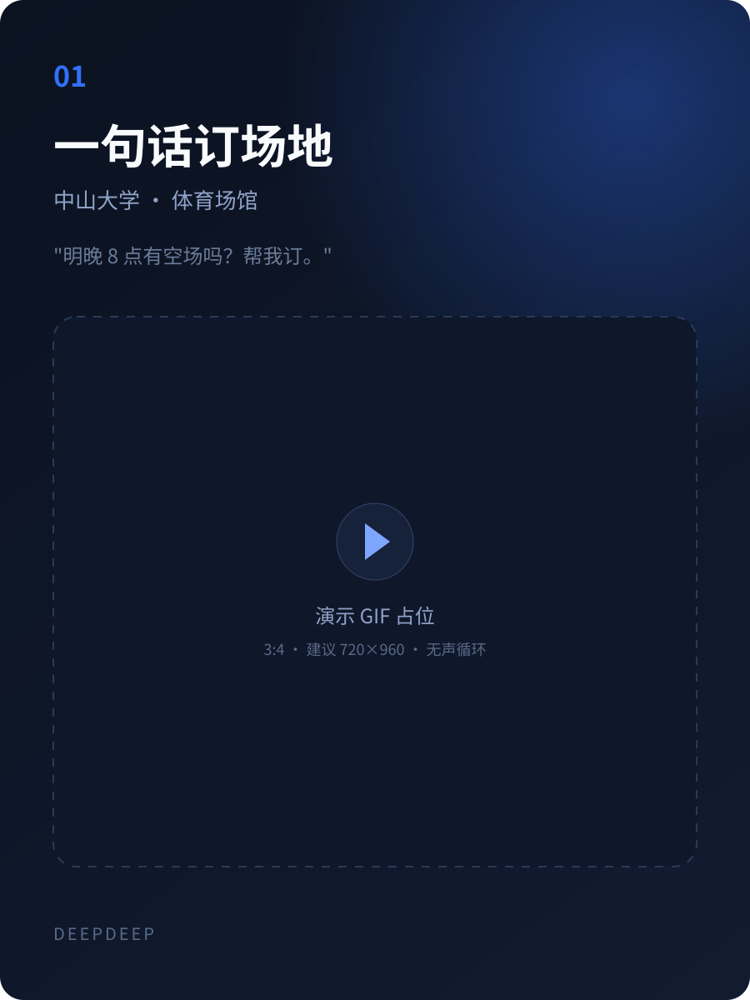
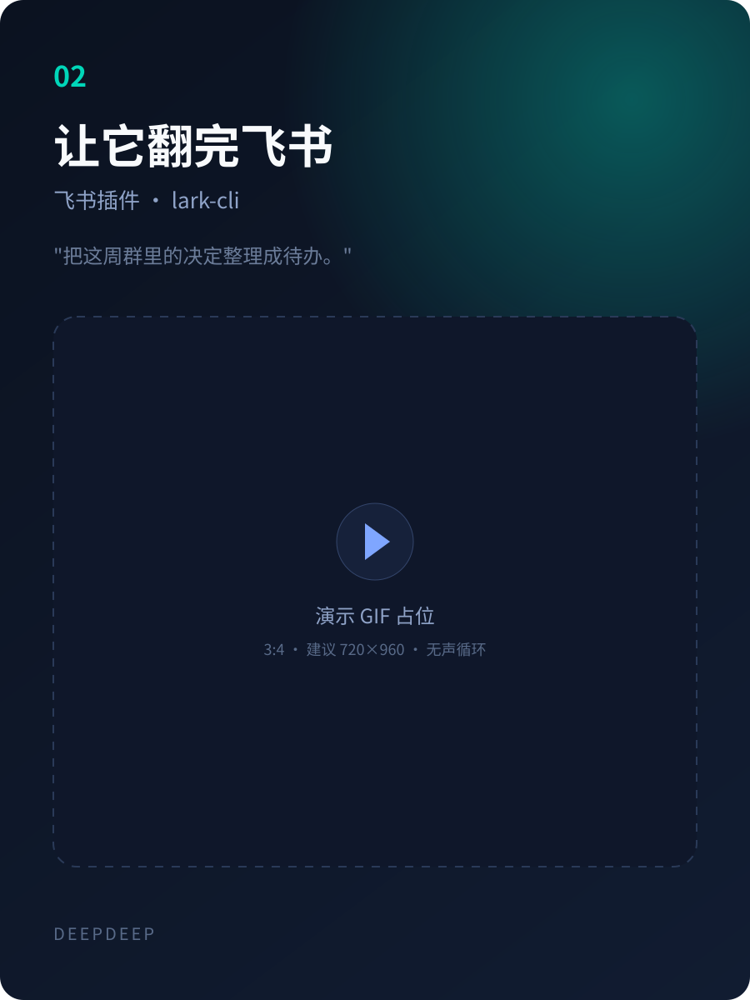
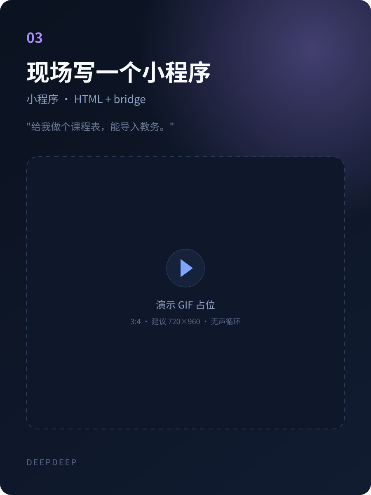

<div align="center">


# DeepDeep

**住在你手机里的个人 Agent。**

不只会聊，还会替你把事办完：跑 Linux、操作屏幕、装插件、写小程序。

<a href="https://github.com/Sadami3066"></a>


<br/>
<br/>



<sub>实机演示占位 · 一句话查空位、订场地、写日历（之后替换为 GIF）</sub>

</div>

DeepDeep 不是把网页聊天框塞进手机。它把 **agent runtime、一个 Alpine Linux、可插拔的插件系统和一块可编程的界面** 放进 Android：

模型用你自己的 Key，会话与文件留在设备上，任务在后台继续跑。**不需要 root。**

## 为什么是 DeepDeep

| | |
|---|---|
| **真的能动手** | 不只是生成文本。`bash` 跑命令，ADB / Root 碰系统，`screen_*` 点按滑动输入；权限分三档，你决定给到哪一层 |
| **能力是装上去的** | 插件可以带工具、技能和自绘页面；MCP 接现成服务；技能把「你的流程」教给它。官方插件覆盖飞书、企业微信、中山大学、小米云服务 |
| **界面可以现场写** | 一句话生成一个小程序：HTML + CSS + JS，WebView 渲染，数据按应用隔离，还能添加到桌面 |
| **一直在手机里** | 后台任务、定时提醒、目标续跑、悬浮窗和系统助手。你继续用手机，它在后台把事做完 |

## 三个瞬间

<table>
<tr>
<td align="center" width="33%"><br/><b>一句话订场地</b><br/><sub>查空位、比时间、下单、写进日历</sub></td>
<td align="center" width="33%"><br/><b>翻完飞书消息</b><br/><sub>群聊、文档、日历，最后整理成待办</sub></td>
<td align="center" width="33%"><br/><b>现场写一个小程序</b><br/><sub>课程表、记账、纪念日，打开就能用</sub></td>
</tr>
</table>

<sub>以上为演示位，实机 GIF 录制中。录制规格见 [docs/media/SHOTS.md](docs/media/SHOTS.md)。</sub>

## 能做什么

| | |
|---|---|
| **对话** | 42 家 Provider，API Key 或 OAuth 登录；模型与思考档按会话独立；Markdown、代码、表格、语音进出、附件、token 与费用统计 |
| **动手** | Alpine / proot 里的 `bash`，Node、Python 等按需安装；后台任务、定时任务、目标续跑；可选无线调试 `adb_shell` 或 `root_shell` |
| **屏幕** | 后台虚拟屏里启动 App、观察、点击、滑动、输入、截图；也可以显式操作主屏。悬浮窗可看实时缩略图 |
| **接入** | MCP（含 OAuth）、`.ddp` 插件、技能、系统日历、分享接收、远程连接电脑上的 DSH |
| **造物** | 小程序：Agent 按需求写页面，经 bridge 读写自己的数据，也能调用一次性 Agent；可添加到桌面 |
| **系统** | 前台服务、通知中心、系统助手浮层、悬浮胶囊、深链接；不打断你正在用的 App |
| **数据** | 会话以 pi JSONL 存在本地；密钥加密存储；没有 DeepDeep 账号，也没有中转服务器 |

## 第一次打开

1. **连一个模型**：推荐 DeepSeek，也可以选 Anthropic、OpenAI、Gemini、OpenRouter、Kimi 等；支持浏览器 OAuth 或 API Key。
2. **装好 Linux 环境**：首次进入「Linux 设置」按提示初始化 Alpine；之后 `bash`、Node、Python 都能直接用。
3. **选权限档**：普通档只有 `bash`；需要操作 App 时再开无线调试或 Root，随时可以退回普通档。
4. **说一句话**：比如「看看我明天几点上课」「把这份课件整理成复习提纲」「帮我盯着羽毛球场，有空位就订」。

首次安装会走 6 屏引导，可以跳过，也可以中途退出。

## 权限、隐私与边界

### 三档权限

| 档位 | 能力 | 说明 |
|---|---|---|
| 普通 | `bash` | proot 用户空间，**不是安全沙箱**；适合命令、文件、脚本 |
| 无线调试 | `adb_shell` | 用系统「无线调试」配对码连接，App 内嵌 ADB 守护进程；重启后需重新打开无线调试并连接 |
| Root | `root_shell` | 交给系统 root 管理器授权；只在检测到可用后端时注册工具 |

### 屏幕操作

屏幕操作开关默认关闭。打开后还需要 ADB 或 Root 后端实际可用，`screen_*` 才会注册。

- Agent 默认在**后台虚拟屏**里操作，不抢占你正在用的主屏；主屏必须显式 `target=main`。
- 虚拟屏连续 15 分钟没有 Agent 操作会自动关闭省电。
- 支付、密码等受保护页面无法截图，Agent 会把控制权交还给你。

### 插件

- 插件与 App **同进程、同权限，没有沙箱**；只安装可信来源的 `.ddp`。
- 首次安装会展示发布者、sha256 与能力清单，需要你确认信任；之后更新必须同钥。
- 插件可以声明工具、技能、提示词段和页面；登录与账号信息留在插件页，不随对话发给模型。

### 数据

- 没有 DeepDeep 服务器：对话与屏幕内容只发给你配置的模型厂商。
- API Key 加密存在本机；会话、文件、插件数据默认都在设备上。
- 更新检查只访问 GitHub；市场索引经过签名校验。

## 插件与市场

App 不预装插件。官方插件和第三方插件一样，都是签名的 `.ddp`：

| 插件 | 能做什么 |
|---|---|
| **飞书** | 通过官方 `lark-cli` 读写消息、日历、云文档、云空间、邮箱与任务 |
| **企业微信** | 扫码授权后操作消息、邮件、文档、日程与待办 |
| **中山大学 CLI** | 课表、成绩、作业、课件下载、体育场馆预约、网费查询与续费 |
| **小米云服务** | 读取笔记、待办、短信、联系人、相册与录音 |

插件、技能与远程 MCP 都可以从 [DeepDeep 市场](https://github.com/Sadami3066/deepdeep-market) 获取；索引经过 ECDSA 签名，制品核对 sha256。

## 小程序

小程序不是固定模板，而是 Agent 按你的需求现场写的 HTML/CSS/JS：

- 页面通过 bridge 读写自己的 SQLite 数据，按小程序隔离。
- 页面里的 `app.agent.*` 可以编排一次性 Agent，用完即走。
- 做好后可以「添加到桌面」，点图标直接打开。

适合做课程表、记账、纪念日、抽签、小工具，也适合把一次性任务固化成每天都能点的按钮。

## 架构

```text
┌─ Compose UI ──────────────────────────────────────┐
│ 聊天 · 文件 · 设置 · 插件页面 · 小程序 WebView     │
├─ Agent runtime（pi2kotlin）───────────────────────┤
│ pi-ai · pi-agent · pi-coding-agent                │
├─ Tools ───────────────────────────────────────────┤
│ read/write/edit/bash · screen_* · job/timer/goal  │
│ miniapp · MCP · plugins · calendar · web_search   │
├─ Android ───────────────────┬─ Linux（proot）─────┤
│ ADB / Root · WebView · 通知 │ Alpine · Node · sh  │
└─────────────────────────────┴─────────────────────┘
```

<details>
<summary><b>从源码构建</b></summary>

需要 JDK 17+、Android SDK Platform 36 + build-tools 36.0.0。

```bash
./scripts/dev-setup.sh        # 首次：检查环境、写 local.properties、拉 SDK、出 APK
./scripts/check.sh            # 日常：编译 + 单测 + lint + 模块边界 + APK
./scripts/check.sh --full     # 交付前：再加插件 SDK ABI 基线
./scripts/check.sh --device   # 再加覆盖安装到手机并启动
```

`dev.pi` SDK 由 Gradle 任务从 pi2kotlin `v0.4.0` Release 下载并校验 sha256，不依赖本机 `~/.m2`。所有 Gradle 调用走 `./scripts/gradlew-locked`（全局串行锁；本机并发构建会 OOM）。

</details>

## 状态

**1.0.0 · Private Beta。** 目前由作者本地构建与分发，没有上架应用商店；源码暂未公开。接口、插件 API 与界面仍可能变化。

已知边界都写在 [docs/GUIDE.md](docs/GUIDE.md)，包括：不做二次审批、proot 不是沙箱、插件同权限、远程连接一次一台电脑等。

## 文档

- [功能与边界](docs/GUIDE.md)
- [设计取舍](docs/DECISIONS.md)
- [插件开发](docs/PLUGIN_DEV.md)
- [素材与录制规格](docs/media/SHOTS.md)

## License

自有代码 [Apache-2.0](LICENSE)。随包分发的第三方组件与字体、图标许可见 [THIRD_PARTY_NOTICES.md](THIRD_PARTY_NOTICES.md)。

---

<sub>Built on [pi](https://pi.dev) · [pi2kotlin](https://github.com/Sadami3066/DeepDeep-KotlinSDK) · Alpine Linux · Jetpack Compose</sub>
