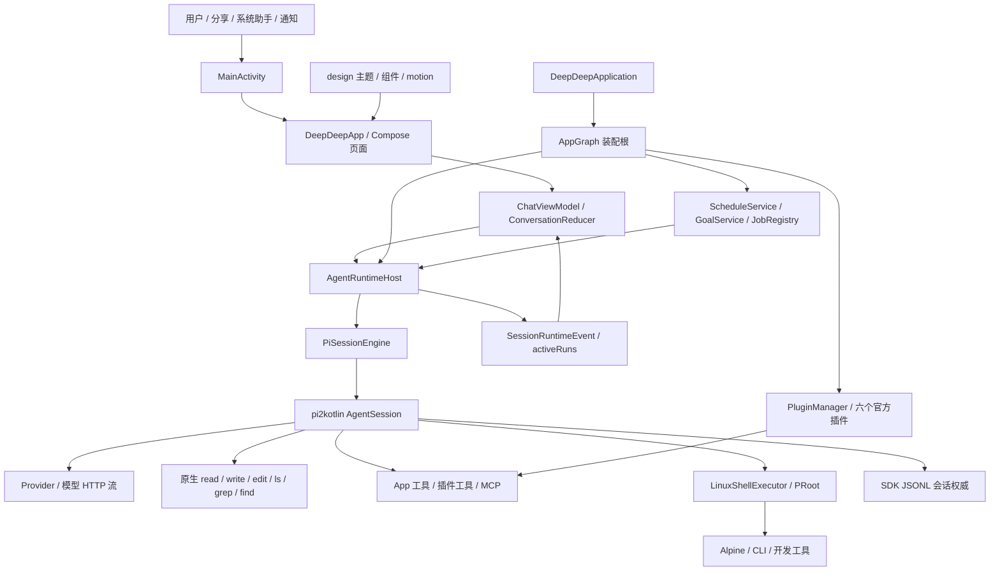
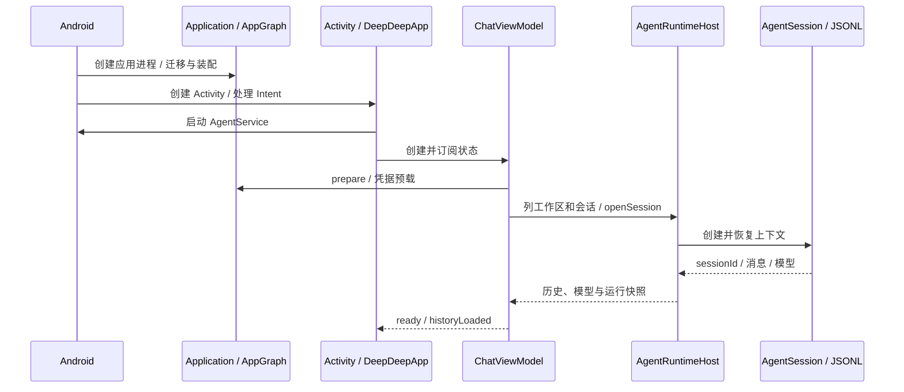
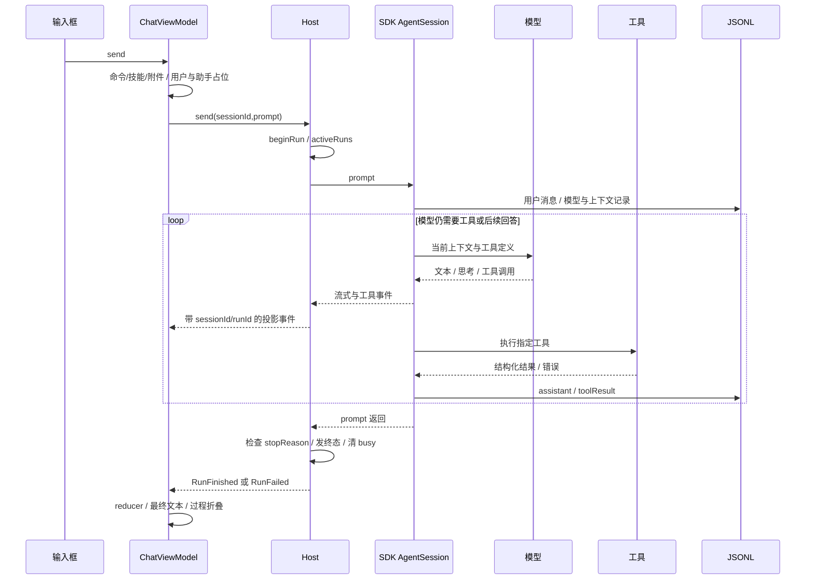
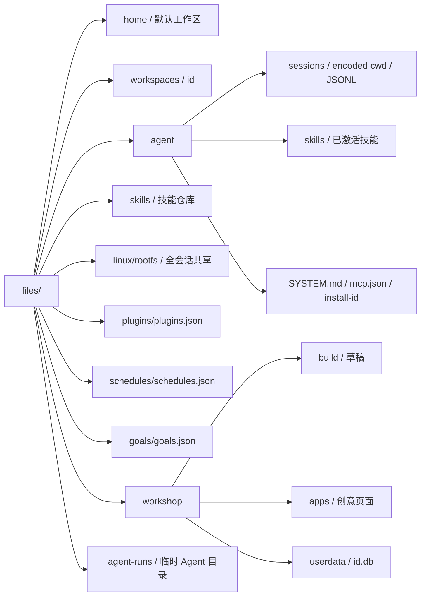
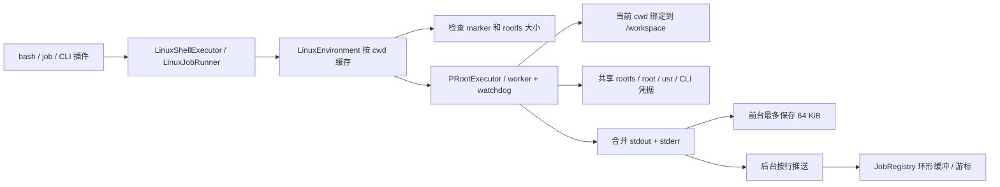
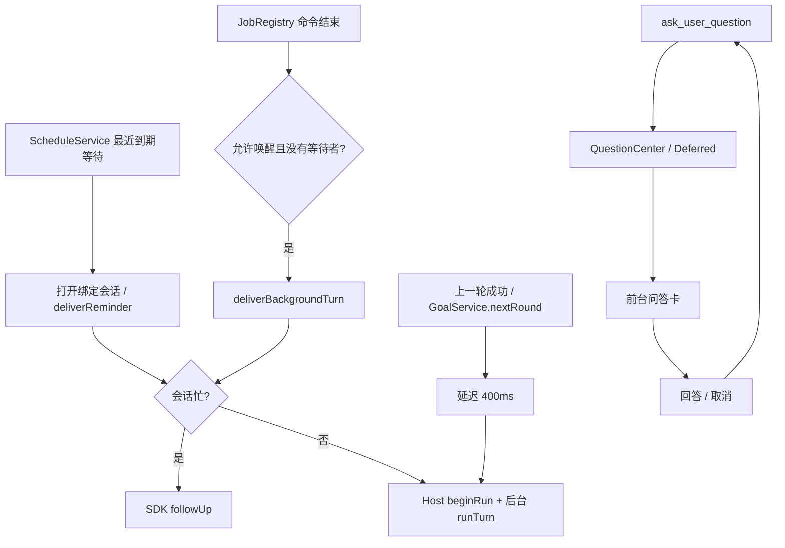
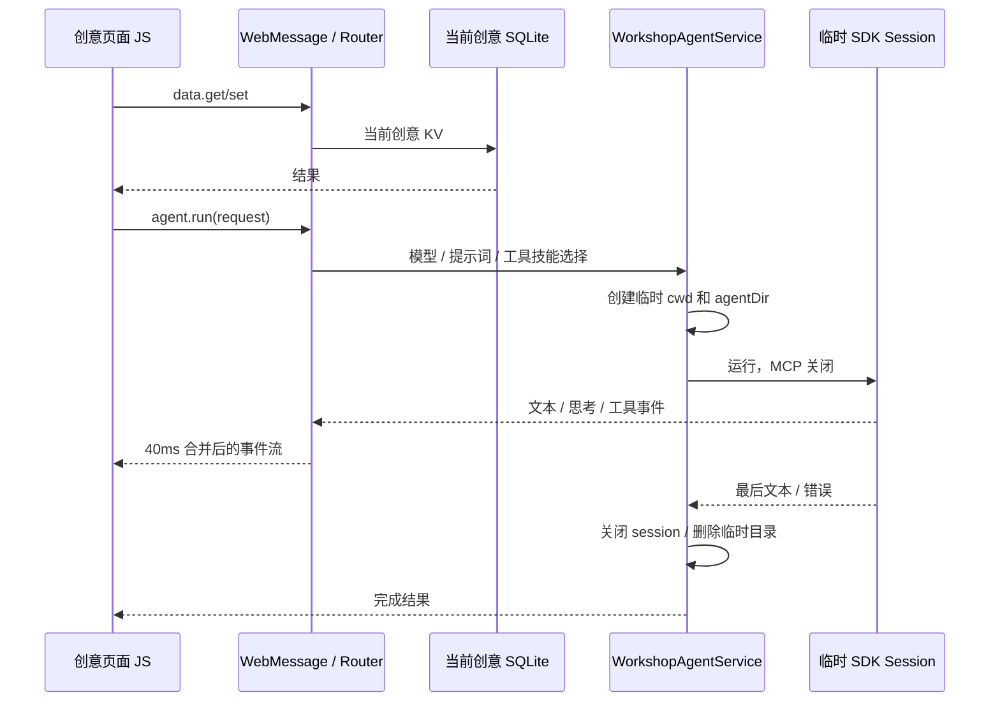

# 架构与完整运行链

本文件解释运行机制；[逐文件图册](02-MODULE-ATLAS.md)负责把每个小文件对应回来。下文的“会话”是多轮模型上下文，“一次运行”是某次发送及其模型/工具循环，“后台命令”是 job，“目标”决定是否继续发起下一轮；四者不能互相代替。

## 1. 程序真正由哪几层组成

`:app` 依赖 `:runtime/:shell/:design`，后三者不互相依赖。这个约束有构建检查，但它只检查 Gradle 项目依赖，并不检查大模块内部的包依赖、业务职责、同会话并发和 SDK 类型泄漏。

| 层 | 代码规模 | 真正负责什么 | 不应误解成什么 |
|---|---:|---|---|
| app | 160 文件 / 34,047 行 | Android 界面、系统入口、权限/无障碍/语音/日历、插件实现、装配 | 不是纯 UI；里面有相当多集成和业务协调 |
| runtime | 51 / 8,843 | 会话宿主、SDK 适配、应用工具、提醒/目标/任务/工坊、配置与部分持久化 | 还不是可直接搬到任意平台的纯核心；含 Android Keystore、DataStore、SQLite、Log |
| shell | 7 / 847 | rootfs 安装、PRoot 命令执行、取消/超时、SDK ShellExecutor 适配 | 不是 Agent loop，不是独立 Linux 系统，也不是虚拟机 |
| design | 12 / 1,702 | 颜色、字体、图标、动画、通用交互组件 | 不是业务状态和页面路由 |
| 外部 pi SDK | 实际使用 0.2.2 | Provider、模型流、Agent loop、工具执行、消息持久化、压缩、MCP | 不等于 App 已经正确使用所有生命周期能力 |

核心证据：[构建依赖](/home/whywood/project/DeepDeep/build.gradle.kts:12)、[AppGraph](/home/whywood/project/DeepDeep/app/src/main/kotlin/io/github/whywood/deepdeep/AppGraph.kt:85)、[会话创建适配](/home/whywood/project/DeepDeep/runtime/src/main/kotlin/io/github/whywood/deepdeep/runtime/PiSessionEngine.kt:44)。

## 2. 从点击图标到聊天可用

1. Android 创建进程，调用 `DeepDeepApplication.onCreate()`，同步构造 `AppGraph`。
2. `StorageMigration` 在新的 home/workspaces/session 路径被使用前修复旧数据。创建 `files/home`、`files/workspaces`、`files/agent`。
3. 装配凭据、Provider、设置、会话目录、技能、工坊、Linux 门面。部分服务用 `lazy` 延后构造；后台 `SupervisorJob + Dispatchers.IO` 收集偏好、初始化插件并在空闲时重配 Host。
4. `MainActivity` 包装语言 Context，处理分享/助手/通知/回调 Intent，启动 `AgentService`，加载主题/字体并设置 Compose 内容。
5. `DeepDeepApp` 创建 Activity 所属的 `ChatViewModel`，并把 Host、目录、存储、技能展开器注入进去。
6. ViewModel 先订阅事件/busy，再 `prepareRuntime()`：迁移旧工作区、可选 debug key 导入、预载加密凭据。随后恢复工作区和最近会话/新建会话。
7. 打开现有会话时，Host 在全局 mutex 下创建 `PiSessionEngine` 和 SDK session，按 JSONL 恢复模型/思考等级，再建立事件订阅。
8. 界面先显示已有 `conversationCache`，后台读取权威历史/模型/usage，再检查是否仍在运行，决定是否清除过期 sending。

启动静态热点：迁移、内置技能文件检查，以及 `LinuxEnvironment` 构造时对已安装 rootfs 的目录大小扫描，都可能进入 Application 的同步构造阶段。并非所有装配都只是创建轻量对象。

## 3. 发出一条消息后如何运行

### 3.1 输入归一化

`ChatViewModel.send()` 检查 ready/historyLoaded、当前会话、sending/切换状态，裁剪空白并解析命令。人用 `/compact`、`/goal` 由应用命令处理；技能引用经 `SkillCatalog` 展开为提示词。附件通过 `<attachments>` 文本块描述实际工作区文件，引用内容由 `buildPrompt()` 拼接。

发送的 UI 先乐观添加用户消息和一个运行中的助手占位，清空输入/附件/引用，设置 sending。随后等待当前会话的打开任务，调用 `runtime.send(sessionId,prompt)`。**这次用户主动发送的运行协程属于 ViewModel；后台提醒/目标/任务唤醒由 AppGraph 的后台 scope 推动。生命周期归属并不完全统一。**

### 3.2 Host 的一次运行

Host 找到 Handle，`beginRun()` 生成 UUID runId，写 turnSource、startedAt、busy、stopRequested、terminalEmitted，并发布 `busySessionIds` 和 `activeRuns`。新会话尚无标题时先追加标题，以便抽屉立即看到会话。

然后发布 `RunStarted`、`Thinking`，调用 `session.prompt(text)`。模型回答需要工具时，SDK 执行工具，写入结果，再让模型继续。这整个内部循环由 SDK 负责；DeepDeep 没有在 Host 里重写一个模型/工具 while-loop。

### 3.3 流式更新不是直接改界面

- SDK `TextDeltaEvent/ThinkingDeltaEvent` → Host `TextDelta/ReasoningDelta`。
- 工具开始/结束 → `ToolStarted/ToolFinished`，携带 callId、参数、输出/错误、耗时。
- App 全部事件加上 sessionId；当前运行再加 runId，UI 可以拒绝旧轮的迟到事件。
- 当前聊天 delta 约每 16ms 批处理；`ConversationReducer` 在不可变消息列表上追加/合并步骤；后台会话更新缓存。
- `ChatTurn` 组合最终回答、ProcessSection、ReasoningCard、ToolCard、PresentCard 和问答卡。MarkdownParser 先构建 AST，再由 ChatMarkdown 显示。
- Host 事件缓冲容量 512。满时文本/思考 delta 可丢弃，结构事件放到后台协程补发。最终 `activeRuns` 与历史对账用于修复 UI 运行状态；这不保证所有中间推理/工具显示天然无损有序。

证据：[发送入口](/home/whywood/project/DeepDeep/app/src/main/kotlin/io/github/whywood/deepdeep/ui/chat/ChatViewModel.kt:176)、[运行起止](/home/whywood/project/DeepDeep/runtime/src/main/kotlin/io/github/whywood/deepdeep/runtime/AgentRuntimeHost.kt:286)、[归约器](/home/whywood/project/DeepDeep/app/src/main/kotlin/io/github/whywood/deepdeep/ui/chat/ConversationReducer.kt:29)。

## 4. 会话、工作区、消息与运行状态的权威

| 数据 | 权威位置 | 其他副本的角色 |
|---|---|---|
| 模型消息、工具结果、模型/思考变化、压缩/上下文编辑 | SDK JSONL | SDK 内存是当前运行视图；UI reducer/cache 是显示投影 |
| 当前运行 id、起始时间 | Host `activeRuns` | busy/发送状态用于显示与对账，不应反向决定执行权威 |
| 置顶、归档、标题覆盖 | SessionMetaStore / DataStore | JSONL 原始标题仍可存在，目录叠加覆盖 |
| 工作区 id/name/cwd | WorkspaceStore / DataStore | Home 由 Host 固定提供；实际文件在 cwd |
| 新会话默认模型 | ModelConfigStore / DataStore | 现有会话使用自身 JSONL 模型变化恢复 |
| Key / Provider OAuth / MiCloud Cookie | EncryptedSecretStore | SDK 需要同步读取，所以 SdkCredentialStore 另持内存缓存 |
| MCP 配置 / token | `agent/mcp.json` / `agent/mcp-auth.json` | 会话内 McpManager 有连接和 deferred 工具状态 |
| 提醒 / 目标 | schedules JSON / goals JSON | 调度和 armed/运行轮次存在内存，不能把存了配置等同于存了全部执行状态 |
| job / 待回答问题 | 内存 Registry / QuestionCenter | 进程死亡后不会原样恢复运行记录和等待协程 |
| 工坊页面 / 工坊数据 | HTML 文件夹 / 每创意 SQLite KV | WebView DOM 与 JS 状态仍可能是临时状态 |

SessionCatalog 扫描所有已知 cwd，再叠加 meta。SDK 当前列会话会读取整份 JSONL；App 的 `refreshSessions` 还会分别获取未归档与归档列表，可能重复扫描。目录并不是一个可增量查询的数据库索引。

HistoryMapper 把多个 SDK assistant/toolResult 合成一轮 App assistant，并把中间思考和工具留在过程区。提醒通过 `[定时提醒]` 文本前缀恢复显示，不是所有后台通知都作为同一种持久领域事件存储。

## 5. 提示词、模型与凭据

`PiSessionEngine.createSession()` 的工作顺序是：确保全局 SYSTEM.md → 解析 fallback 配置 → 如果打开文件则读取其模型 → 构建工具和 SessionBinding → 生成初始 section → `createAgentSession()` → 绑定 session。

工具定义通过 SDK/provider 的真实 tools 字段发出；文字提示词中的规则只说明怎么用。`SYSTEM.md` 的自定义前言、工具 guidelines、动态 environment、长期 instruction、插件 prompt、技能和工作区文档共同影响模型。environment 按天更新日期，读取 session 当前模型和 cwd，避免每一帧/每一秒改变 system prompt。

ProviderCatalog 从 SDK 目录映射 App 模型/思考等级。ProviderOAuthService 调 SDK OAuth flow，Android loopback 工厂承接浏览器回调并跳回 `deepdeep://oauth/...`。安装身份通过 `install-id` 保持稳定。MCP OAuth 走独立 token store。

凭据的关键结构是“异步磁盘 + 同步 SDK”：Key/OAuth 原始 JSON 加密落 DataStore，SdkCredentialStore 缓存给 SDK 同步读，同时发布 authKinds/revision 给界面。缓存立即变化、磁盘写入另起协程，所以排序/失败/进程死亡窗口需要专门治理，不能仅依赖 DataStore 本身单次写事务。

## 6. 工具系统的各条边

| 家族 | 工具 | 执行位置与回传 |
|---|---|---|
| SDK 文件 | read/write/edit/ls/grep/find | Android 宿主文件系统，cwd 是当前真实工作区；结果回 SDK |
| SDK shell | bash | LinuxShellExecutor → LinuxEnvironment → PRoot → Alpine `/bin/sh -c` |
| 提问 | ask_user_question | QuestionCenter 挂起，用户交互卡完成 deferred，答案回工具 |
| 提醒 | schedule_create/list/update/delete | ScheduleStore/Service，绑定原会话文件和 cwd |
| 目标 | get_goal/create_goal/update_goal | GoalService 持久化阶段与轮次，Host 在成功终态后请求下一轮 |
| 后台命令 | job_start/output/list/kill | JobRegistry → LinuxJobRunner，立即返回 id，后续按游标读取 |
| 交付 | present | 返回文件/图片/HTML/创意结构，App 恢复卡片并打开/分享 |
| 插件设置 | plugin_setup | runtime PluginController → App PluginManager → 同一 setup sheet |
| 工坊 | workshop_create/load/list/data_* | 创意草稿/装载/目录与 SQLite 数据 |
| 官方插件 | web_* / gui_* / arrange_calendar / mi_cloud_* | 各插件自行实现 Native/HTTP/无障碍/WebView；CLI 插件主要通过技能指导 bash |
| MCP | tool_search / mcp__server__tool 等 SDK 能力 | SDK McpManager，HTTP 连接、工具按需加载；本 App 配置页主做 Streamable HTTP |

`AppTools` 是统一注册点，`SessionBinding` 解决“工具先构造、session 后创建”的循环。这个适配是合理的。欠缺的是统一的能力作用域、输出存档和取消/重试规则，而不是缺少一个总工具列表。

## 7. Linux 如何工作以及共享了什么

`LinuxRootfsInstaller` 校验捆绑 Alpine 3.24.2 aarch64 rootfs 的 SHA256，解包到临时目录，写 marker，再发布到 `files/linux/rootfs`。PRoot 二进制来自 arm64-v8a 的 native library 目录。当前 Linux 仅支持 arm64-v8a。

每条 bash 启动一次 PRoot，绑定 `/dev /proc /sys`、当前宿主 cwd→`/workspace`，以及 skills、skill-repo、gui、micloud 等目录；共享存储开关允许 `/sdcard` 映射。环境变量在进程启动时显式设置，命令由 guest `/bin/sh -c` 执行。

不同会话的 `/workspace` 不同，但 rootfs、`/root`、CLI 登录态和全局技能目录是共享的。用户在会话 A 安装包，会影响 B。这不是每会话一个容器。临时工坊 Agent 如果取得 shell，也会复用同一个执行环境结构。

前台 bash 默认 60 秒、允许 1..600 秒；job 最多 24 小时。超时/取消尝试杀死进程树。前台保存前 64KiB 输出，没有通用溢出文件回读；后台输出实时环形缓冲 256KiB、结束裁成 16KiB，单个任务的增量游标由 Record 保存。

## 8. 六个插件如何接进来

PluginManager 管记录、busy、setup sheet、状态探测、技能和工具贡献，具体插件管自己的可用性/安装/连接/功能实现。插件必须已安装且启用才贡献工具/提示词；当前部分能力变更会等待全部会话空闲后 `host.reconfigure()`，关闭并重新创建全部已打开 session。

| 插件 | 小模块合作关系 | 真正依赖 |
|---|---|---|
| 飞书 | FeishuPlugin 生命周期 → FeishuCli 命令/JSON → Linux → 官方 CLI；附带技能和提示词 | Linux、CLI 下载、用户授权 |
| 企业微信 | WecomPlugin → WecomRuntime → WecomCli，暂存环境支持安装过程 | Linux、CLI、扫码授权 |
| 网络搜索 | WebSearchPlugin → WebTools → WebProvider → DeepSeekWebProvider | HTTP、DeepSeek API Key；不需要 Linux |
| GUI | GuiPlugin → GuiTools → GuiActions → GuiAccessibilityActions → 系统服务；GuiNodeTree 处理快照/选择器 | 用户开启无障碍，系统窗口/手势接口 |
| 安排 | ArrangePlugin → ArrangeTools → ArrangeRequests/CalendarGateway → CalendarContract | 读写日历权限；当前不提供闹钟 |
| 小米云 | MiCloudPlugin/Preferences → LoginActivity/CookieStore → Client 读取与 WebWriter 同源写入 → Tools/Parsers | i.mi.com 登录、各功能开关；不是标准 Android 系统联系人接口 |

需要区分：设置页“连接成功”、某个工具返回成功、某个真实外部业务任务最终成功，是三种证据。本轮没有重新验证飞书/企业微信/小米云真实账号流程，也没有向这些服务发送消息。

## 9. 提醒、目标、job 和提问怎样推动会话

- 提醒：存储 changes 与 runtime events 驱动刷新；同会话同时到期的提醒合并一次投递。`deliverReminder()` 返回表示已交给运行层/排队，不表示模型已经完成任务。当前 JSON 中的 delivered 不能直接当业务完成证明。
- 目标：持久化 objective/phase/roundsStarted/maxRounds/revision；armedSessions 只在内存，重启后需手动继续。成功后 Host 请求下一轮并延时 400ms 发起。默认 maxRounds=0 表示无轮次上限；不是自动衡量目标完成度的规划器。
- job：每会话最多 10 个；立即返回 id；await/read/kill 与完成唤醒分离。JobRegistry 内存记录不随进程重启恢复；进程实际执行与 UI 状态恢复需要更强契约。
- 提问：只在发起时要求前台；如果稍后进入后台，已有 deferred 仍然等待。没有持久问题队列/回答日志作为执行恢复基础。

## 10. 工坊页面与一次性 Agent

创建路径：普通聊天 Agent 调 `workshop_create` 得到 build 目录 → 写 HTML/CSS/JS/manifest → `workshop_load` 校验入口、目录和内容并移到 apps → `present` 返回入口卡。

打开路径：WorkshopScreen 扫描 → Viewer 创建对应 SQLite data → WebViewAssetServer 提供 `https://<id>.workshop.local` → 注入 bridge.js → 页面通过 `app.data.* / app.ui.* / app.agent.*` 调 WebMessage → Host 验证 origin/main frame → Router 分发。

一次性 Agent 默认最多 16 个模型 turn，允许 1..64；prompt 主运行超时 180 秒。**实际存在的边界**：网页资源按创意目录限制；bridge 限制 origin/main frame；data 绑定当前创意。**尚未形成的边界**：Agent 文件工具没有被限定在临时 cwd，shell 后端共享环境，部分 App 工具仍然可见；也没有一个所有 bridge 请求共用的并发/总费用预算。不要把前一类边界扩大表述为后一类已经隔离。

## 11. 停止、失败和恢复

停止当前路径：UI→`Host.stop()`，立即发 STOPPED 终态，再 `session.abort()` 发取消信号。SDK 0.2.2 还有 `waitForIdle()` 和 `Settled`；当前 Host 停止语义没有统一等到这些信号后才完成状态转换。随后 runTurn 的 finally 清 busy/activeRuns，UI 必要时从 history 重建。

失败路径：Host 检查末尾 stopReason 并区分 Error/Aborted，SDK SessionError/RetryExhausted 也会走终态。ViewModel 再根据本地化错误类别决定最多 5 次、间隔 2 秒的自动重试；手动重试调用 SDK `retryLastAssistant()`，用 context edit 移除末尾失败 assistant 后继续，避免重复用户消息。

恢复路径：JSONL 重建历史、模型与上下文；DataStore/JSON 恢复工作区/配置/目标/提醒；busy/activeRuns 与内存缓存不跨进程保留；job 和未答问题没有完整执行恢复。进程死亡不会因为运行环境是 Linux 就消失：PRoot 命令仍属于 Android 应用生命周期下的进程资源。[Android 官方进程生命周期](https://developer.android.com/guide/components/activities/process-lifecycle)说明进程存活由系统综合决定。

## 12. 非 Kotlin 内容也是架构的一部分

- Gradle 四模块、版本目录、Java 17 字节码/Android API 29..36、Maven Local SDK 发布，是可构建性的边界。
- Manifest 定义 Android 入口、前台服务、无障碍服务、FileProvider、系统权限与 Intent 过滤器。
- res/values 与 values-en 提供本地化；design 管字体/图标/视觉。资源回退机制不等于所有界面文本都经过统一错误映射。
- `assets/workshop/bridge.js` 是网页端 RPC/事件入口；`assets/skills/workshop` 的技能/教程/示例是 Agent 产品行为的一部分，需要和 bridge/工具版本同步。
- shell 的 rootfs 和 libproot/libproot-loader 是实际交付的运行资产；THIRD_PARTY_NOTICES 和许可证目录是分发约束。
- `docs/DEVICE_TESTING.md` 是手工场景清单，不等于这些场景已经自动化通过。本次未执行其中的真实账号/真机性能矩阵。

