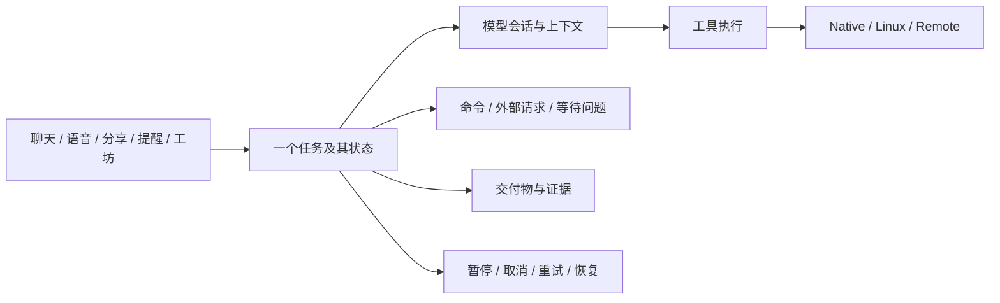
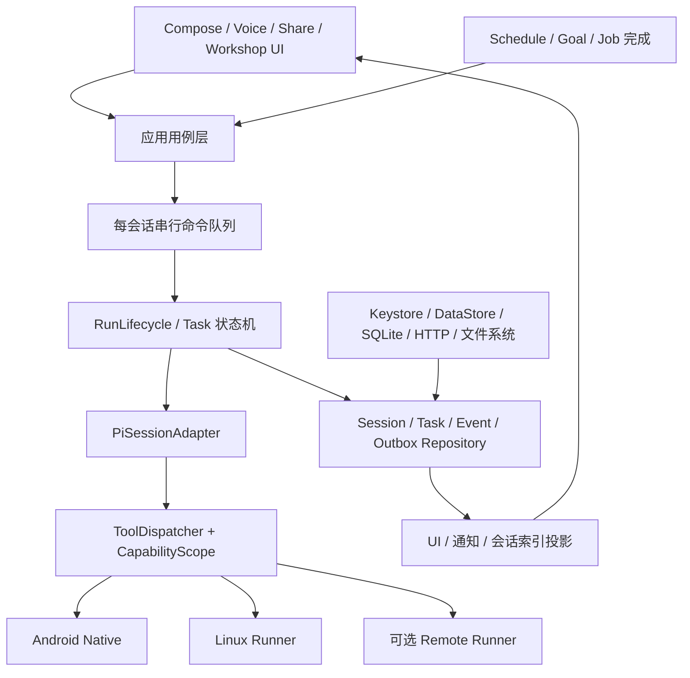

# 产品方向与架构整合建议

## 1. 建议选择的路线

**保留 Android 原生宿主和 pi2kotlin，把 Linux 定位为可选、可替换的执行后端；先统一任务和会话运行规则，再增加能力。** 当前缺陷没有证据表明是 Kotlin/Compose 或 SDK 适配这种路线本身造成，换到 Linux 不会自动修复停止、持久化、升级和权限作用域问题。

Android 应用本来运行在 Linux 内核之上；这里真正要选择的是“Agent 控制逻辑运行在 Android/Kotlin 进程，还是运行在 PRoot/Termux 中的独立服务”。PRoot 是基于 ptrace 的用户态路径/进程环境转换，不提供独立 guest kernel；将控制逻辑放进去仍然受宿主资源和 Android 生命周期约束。[PRoot 官方说明](https://proot-me.github.io/)

### 可选方案比较

| 方案 | 好处 | 新成本与约束 | 对当前产品的判断 |
|---|---|---|---|
| 当前基础上整合：原生 UI/核心 + 可选 PRoot | Android 能力直接调用；少一个 RPC；保留现有资产；普通聊天/搜索/日历不强制安装 Linux | 必须治理 Kotlin 核心时序、工具作用域和进程恢复 | **推荐默认路线** |
| 原生 UI + App 私有 Linux Agent 服务 | 可复用成熟 CLI Agent/Node/Python 扩展生态 | 协议版本、认证、流/重连/关闭、文件映射、服务升级；日历/语音/GUI 仍须 Android 桥；PRoot 仍在宿主约束下 | 只在复用具体生态收益明显时试点，不直接整体迁移 |
| 原生 UI + Termux 外部服务 | 复用用户开发环境、工具包和独立配置 | 额外 App 安装/配置、跨 App 权限/运行桥、更新兼容和用户支持成本 | 专家模式可选后端 |
| 远程 Linux 执行器 | 长时编译/大型 repo 适合远程资源；可做服务器级隔离和持久作业 | 网络、成本、隐私边界、Android 设备能力仍需本地代理；离线能力受限 | 适合以后高负载任务，不能取代本地助手 |
| 所有界面/能力都改成 WebView/Linux | 可能复用网页生态 | 系统角色、无障碍、日历、通知、语音、分享仍需原生适配；本轮没有性能/可维护性证据支持整体替换 | 不建议作为当前重构目标 |

这里没有声称某方案快多少。任何迁移都应对固定任务、同模型/预算、相同取消/恢复条件做对比；当前证据更支持整理控制平面，而非更换执行语言。

## 2. 产品应该围绕“任务”收敛

当前产品已有聊天、目标、提醒、job、插件、MCP、工坊、语音等入口，但用户最终关心的是“这件事现在进行到哪里、需要我做什么、做完交付了什么、失败能否继续”。建议形成如下产品关系：

- 聊天是任务的交流界面，不必把所有业务状态编码成一段用户消息/助手回复。
- 提醒是任务触发器；“提醒已投递”与“任务已完成”要分开显示。
- 目标是一项跨多轮的持续任务，不应仅靠模型不停自我续跑；系统要知道预算、进度证据和阻塞原因。
- job 是任务的一部分，提供输出/状态/取消；不要让它只在当前进程里有意义。
- 工坊是任务的交互前端和交付物之一，页面的数据、Agent 请求与能力范围应各自明确。
- GUI 是设备操作能力，适合没有结构化 API 的剩余步骤；有系统/服务 API 时优先用结构化接口提高稳定性。这是本项目能力边界的推断建议，不是本轮外部任务成功率实验。

先统一概念和状态，不要求立即把 UI 改成复杂任务看板。当前聊天中增加可信的等待/恢复/交付状态，也能得到实际收益。

## 3. 目标架构：少量清楚的契约

不需要一开始变成十几个 Gradle 子项目。先在现有 runtime 内按下表建立包/接口和所有权，等边界稳定再分构建模块。

| 边界 | 统一负责 | 调用方不得自己做 |
|---|---|---|
| SessionCoordinator | 所有 send/retry/stop/followUp/compact/reconfigure/close；单会话串行化 | 直接修改 handle.runId/busy、靠读取 busy 决定执行 |
| RunLifecycle | accepted/running/stopping/settled/failed/unknown 的合法迁移与 epoch | 在真正停止前把 UI 终态当资源已释放 |
| TaskRepository + Outbox | 触发、等待、子任务、恢复与幂等投递 | 已排队就当业务完成，进程死亡后靠聊天猜状态 |
| PiSessionAdapter | SDK API/事件/stopReason/settled/上下文投影 | 在多个 feature 中重复解读 SDK 状态 |
| ToolDispatcher | 工具注册、作用域、输入/输出、取消与执行记录 | 各工具自行发明权限/输出/重试语义 |
| Workspace/FileAccess | host/guest/展示路径转换、跨入口写入协调与观察版本 | 用临时 cwd 冒充隔离、把 /workspace 当宿主绝对路径 |
| CredentialRepository | 按 Provider 排序的写入/刷新/登出、提交反馈 | 异步无序写、用一个 Set 表示多个待提交版本 |
| PluginLifecycle | 首装/升级事务、能力快照版本和安全点更新 | 失败升级卸载旧版、全局空闲观察后立即重建所有 session |
| UI Projection | reducer、分页历史、消息卡片与展示缓存 | 拥有运行重试策略、成为执行状态唯一权威 |

runtime 内的 Android Keystore/DataStore/SQLite/Log 实现可逐步移到 app infrastructure 或 android adapter；纯领域接口不必 import Android。短期不急于多平台，但这样能独立测状态机，也给未来 Linux/remote 后端留下真实接缝。

## 4. 在动手前固定的数据模型与不变量

### 最小公共模型

| 模型 | 必须字段/语义 |
|---|---|
| Task | taskId、sessionId、来源、状态、created/updated、revision、恢复策略、预算 |
| Run | runId、taskId、epoch、source、state、started/settledAt、outcome、usage |
| PendingCommand | commandId、sessionId、epoch、source、幂等键、排队/接受/完成状态 |
| ToolExecution | callId、runId、工具/作用域版本、输入摘要、状态、输出引用、取消/未知结果 |
| OutputRef | 任务私有文件或可回读存储、字节游标、截断/清理策略 |
| Question | requestId、taskId/sessionId/callId、题目、状态、答案、deadline/恢复策略 |
| Artifact | 稳定 id、类型、路径/URI、工作区、生成者、存在性/可打开状态 |
| CapabilityScope | 允许工具、文件根、创意数据范围、Native 能力、网络/运行器、预算 |

不应把消息 JSONL 和上述所有状态强塞成一个大文件，也不应复制两套消息权威。SDK JSONL 保持模型上下文/消息权威；应用任务记录有自己的事务，使用明确外键/修订号连接。

### 验收前必须成立的十条规则

1. 同一 session 同一时刻只有一个可修改模型执行状态的拥有者；所有入口走该所有者。
2. 每个 run 只有一个最终 outcome；开始、请求停止、完全停止有不同状态。
3. Stop 会取消尚未开始的自动重试/续跑，旧 epoch 的任务不能复活。
4. 进程重启后能区分已完成、可重试、等待用户和结果未知；不会假装所有任务继续运行。
5. 已投递提醒有幂等键和确认点；重复唤醒不重复执行，崩溃窗口不静默丢失。
6. 工坊默认能力是显式允许列表；本创意的数据边界不能靠名字过滤或提示词保证。
7. 所有命令输出可限量保留并按游标读取，任何上游缓冲都不能无限增长。
8. 凭据最新意图按序提交；旧刷新不能在登出/换 Key 后覆盖新状态。
9. 升级失败保留旧可用安装与账号数据，记录/技能/实际二进制保持一致。
10. UI 从权威快照和事件投影；缓存、事件丢包或页面重建不改变任务执行事实。

## 5. 工具与执行环境如何进一步整合

### 原生、Linux、远程用同一执行契约

现有 ShellExecutor 接缝应继续保留，但扩展为“开始/输出/等待/取消/关闭”的运行器契约。PRoot、Termux 或远程执行器的能力必须可查询：是否持久任务、是否可隔离、是否可访问共享目录、可用资源、最大输出。不要让界面通过某个类是不是 LinuxEnvironment 推断能力。

前台 bash 超时与后台 job 不必自动互相转换；用户/Agent 可以显式选择。无论选择哪条路，都应得到可解释的终态和输出引用。PRoot 的输出存到 App 管理的任务目录，再把有限尾部喂给模型，后续需要再按游标读取。

文件修改需要按 canonical workspace/path 协调，不仅按单个 session 的 FileMutationQueue。高价值更新可采用读时观察版本、提交前检查、临时文件原子发布；bash 直接写文件无法完全纳入原生 edit 队列，应在契约中承认并检测外部变化。

### 能力范围不等于每次审批

产品当前明确“不做通用审批系统”，这不是本报告要求推翻的点。可以在不增加每次弹窗的前提下，为主助手、工坊一次性 Agent、远程 Agent 设定不同默认能力作用域。用户明确启用插件/共享目录后，在该范围内直接执行；工坊不应自动继承整个主助手环境。

## 6. 功能建议：先补闭环，再扩面

| 建议 | 解决的用户问题 | 依赖条件 |
|---|---|---|
| 可信任务状态与恢复入口 | 用户不知道是否还在做、失败后从哪里继续 | 持久任务/事件、unknown outcome、恢复策略 |
| 跨前后台的待回答队列 | 切走后忘了回答、进程重启丢失等待 | 持久 Question、去重与归属；不要后台无限挂起 |
| 结果/交付物统一入口 | 文件/HTML/创意散在过程卡里，难回找 | Artifact 类型与稳定 URI、存在性复核 |
| 目标预算与证据 | 无限轮可能原地打转、费用难预期 | 总 token/时间/成本/重复失败预算；目标完成需产物/检验 |
| 结构化设备能力优先 | GUI 任务对界面/窗口变化敏感 | 日历/API/CLI 能做的先走对应能力，GUI 补空缺 |
| 工坊 API 版本与数据更新契约 | 页面代码更新后数据丢失或旧 bridge 不兼容 | manifest apiVersion、SQLite 迁移、页面与数据独立版本 |
| 本地/远程执行器选择 | 手机不适合大型编译/长时爬取 | Runner 接口、断线恢复、明确本地数据发送边界 |
| 凭据/连接健康反馈 | 已配置却实际不可用、刷新失败难解释 | 可 await 提交与真实健康检查，不在每次状态刷新发业务操作 |

暂不建议继续并行堆叠更多登录/更多工具/更多自动续跑来源。它们会共同依赖尚未统一的运行和恢复基础。也不建议先引入复杂微服务或重型工作流引擎；当前规模可以先用明确的 Kotlin 状态机/持久表和端口解决。

## 7. 一次完整整合的执行顺序

这是一项完整的系统整理，每一阶段服务同一组不变量；不是每次选一个简单任务做演示再追加补丁。

| 阶段 | 先固定的产物 | 实施范围 | 退出条件 |
|---|---|---|---|
| A：契约冻结 | 数据模型、状态迁移表、来源/取消/恢复/能力/路径/输出契约、验收矩阵 | 文档和接口设计，尚不迁移执行语言 | 所有现有入口都能映射到契约，没有第二套权威 |
| B：运行核心 | SessionCoordinator、epoch、settled、重试预算 | Host/SDK adapter，UI 只提交命令 | 多入口/停止/重配/取消场景通过 |
| C：数据可靠性 | JSONL 尾部修复、凭据顺序、任务/问题/outbox | pi2kotlin + 应用持久层，分别发布/集成 | 崩溃注入后无丢新记录、无旧任务复活 |
| D：能力与环境 | Scoped 工具、Runner/output/file contracts、插件事务 | 工坊、shell、插件；日历日期专项修复 | 范围越界被拒、升级回滚、无界输出消除 |
| E：界面与性能 | feature coordinator、索引、增量解析、资源预算 | 大组件/缓存/存储读取关键路径 | 交互不退化，性能数据可重复；真机测试另按授权执行 |
| F：产品扩展 | 任务/交付物体验、可选远程后端 | 依赖前述稳定接口 | 全场景验收与回归，不只 happy path |

不先改 UI 样式、不先换 Agent 引擎；优先改最难靠界面补救的执行秩序。每个阶段有可 review 的变更边界与回滚路径，避免一次重写 4.5 万行。

